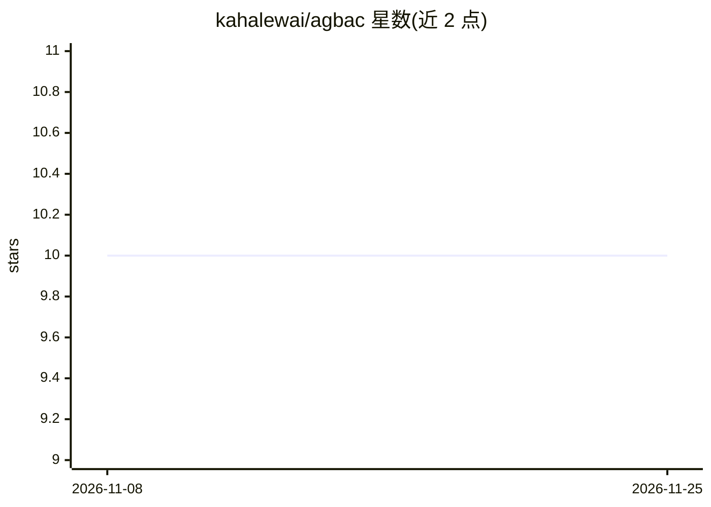

# kahalewai/agbac

⭐ 10 · Apache-2.0 · 推送 2026-11-06 · [GitHub](https://github.com/kahalewai/agbac) · 组织维护

**面向 IAM/企业开发者的 AI 代理双主体授权安全规范**

AGBAC 是一份开放、厂商中立的 Internet-Draft 安全规范，定义 AI 代理代表人类执行操作时的授权机制。核心为双主体授权模型：每个动作须同时验证人类用户与 AI 代理两者均获授权。规范基于既有 IAM 标准（OAuth2、OIDC、RBAC、ABAC、PBAC），通过 OAuth2 Token Exchange（RFC 8693）携带 delegation 元数据实现委托，不引入新令牌格式或身份提供方。README 提供规范使用说明与映射文档链接，规范本身以 Apache 2.0 发布。

## 筛选速览

| 维度 | 判定 | 备注 |
|---|---|---|
| AI 角色 | `ai-ecosystem` | LLM/agent 周边工具 |
| 许可风险 | `permissive` | Apache-2.0 |
| 部署形态 | `None` |  |
| 模型依赖 | — | README 未给出锁定关系 |
| 硬件要求 | — | 无带数字的原话,不猜 |
| 安装摩擦 | `low` | 无编译、无系统依赖或容器化 |
| 成熟度 | — | 结构信号不足 |

## 能力要点

- 双主体授权模型：人类与 AI 代理须分别独立授权
- 基于 OAuth2 Token Exchange（RFC 8693）实现委托令牌
- 复用既有 IAM 标准与基础设施，厂商中立且免版税
- 提供 OWASP Top 10 LLM 风险、NIST 800-207 零信任等映射

## 适用场景

- 为平台设计 AI 代理代表用户执行操作的授权方案
- 企业在既有 IAM 体系上扩展代理身份与审计能力
- 制定代理场景下的最小权限与合规策略

## 场景标签

`网络安全` · 领域:学习与行业

## 证据(README 行号)

> L9: AGBAC (AGent-Based Access Control) is an open, vendor-neutral security specification that defines how AI agents secu
> L52: Using OAuth2 Token Exchange (RFC 8693):
> L90: * Work with OAuth 2.0, OIDC, JWT, and enterprise IdPs

## 星数曲线

2026-11-08 10 → 2026-11-25 10（+0）

---
*卡片 v1 · prompt 1.4 · 生成 2026-11-19 · 置信度 mid · 依据 README sha `cfe9a7b6d637` · [字段定义](../../DATASET.md)*
