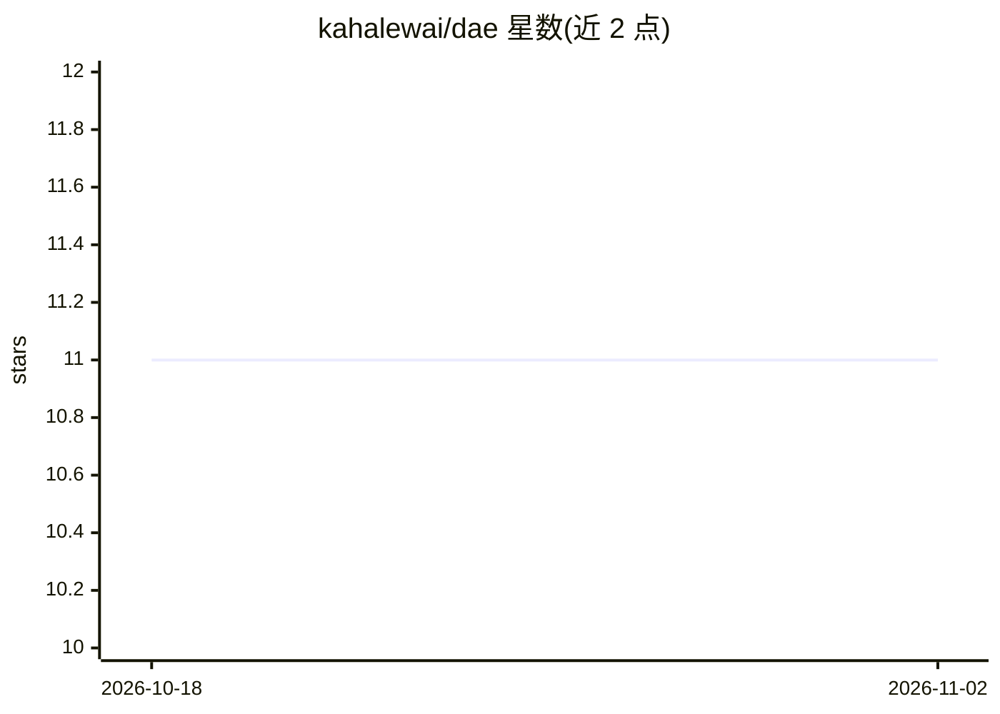

# kahalewai/dae

⭐ 11 · Apache-2.0 · 推送 2026-02-05 · [GitHub](https://github.com/kahalewai/dae) · 个人维护

**AI Agent 安全规范：分离推理与授权的确定性执行标准**

DAE（Deterministic Agent Execution）是一份面向 AI Agent 的开放、厂商中立安全规范（v1.0.0，Apache 2.0）。核心主张是将推理与权限分离：推理系统提出动作，策略系统授予权限，运行时状态机强制执行合规。模型包含意图、计划、运行时状态机、单用授权令牌、执行门、来源强制与撤销七类组件，适用于单 Agent、多 Agent、工具调用 LLM 等场景。仓库仅承载规范文档，参考实现见同作者的 agent-policy-engine 仓库；无安装运行产物。

## 筛选速览

| 维度 | 判定 | 备注 |
|---|---|---|
| AI 角色 | `ai-ecosystem` | LLM/agent 周边工具 |
| 许可风险 | `permissive` | Apache-2.0 |
| 部署形态 | `None` |  |
| 模型依赖 | — | README 未给出锁定关系 |
| 硬件要求 | — | 无带数字的原话,不猜 |
| 安装摩擦 | `low` | 无编译、无系统依赖或容器化 |
| 成熟度 | — | 结构信号不足 |

## 能力要点

- 推理/策略/运行时三权分离的确定性执行模型
- 通过单用、可撤销授权令牌消除隐式权限
- 来源强制组件声明用于阻断提示注入与权限走私
- 规范为实现无关设计，配套 APE 参考实现

## 适用场景

- 为自研 Agent 平台设计权限与执行边界
- 作为安全架构师评审 Agent 系统治理与审计的规范依据
- 参与制定 AI 自主系统的开放安全标准

## 场景标签

`网络安全` · 领域:学习与行业

## 证据(README 行号)

> L9: As AI agents become increasingly autonomous, current architectures rely heavily on probabilistic reasoning systems t
> L13: DAE defines a production-ready, vendor-neutral security standard that separates reasoning from authority and enforc

## 星数曲线

2026-10-18 11 → 2026-11-02 11（+0）

---
*卡片 v1 · prompt 1.4 · 生成 2026-11-02 · 置信度 high · 依据 README sha `595df150b453` · [字段定义](../../DATASET.md)*
