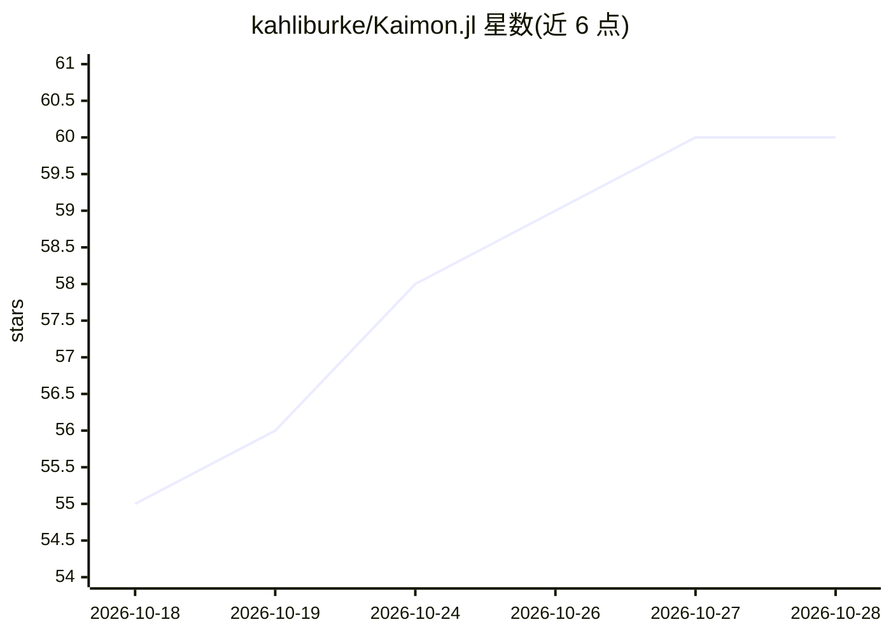

# kahliburke/Kaimon.jl

⭐ 61 · Julia · MIT · 推送 2026-10-27 · [GitHub](https://github.com/kahliburke/Kaimon.jl) · [官网](https://kahliburke.github.io/Kaimon.jl/dev/) · 个人维护

**让 AI agent 通过 MCP 全面操作 Julia 运行时的服务器**

面向 Julia 开发者的 MCP server：将 AI agent（Claude Code、Cursor、VS Code Copilot Chat、Gemini CLI 等）接入活跃的 Julia 会话，默认暴露 49 个工具，覆盖代码执行、类型/方法内省、Infiltrator.jl 断点调试、测试与性能分析、语义代码搜索（Qdrant 向量索引）与 TUI 终端仪表盘。通过可分离安装的 KaimonGate（ZMQ）连接外部 Julia 进程并自动生成 schema 注册自定义工具。提供 strict/relaxed/lax 三种安全模式、API key 与 IP 白名单。要求 Julia 1.12+，Qdrant 为可选依赖。

## 筛选速览

| 维度 | 判定 | 备注 |
|---|---|---|
| AI 角色 | `ai-ecosystem` | LLM/agent 周边工具 |
| 许可风险 | `permissive` | MIT |
| 部署形态 | `None` |  |
| 模型依赖 | — | README 未给出锁定关系 |
| 硬件要求 | — | 无带数字的原话,不猜 |
| 安装摩擦 | `low` | 无编译、无系统依赖或容器化 |
| 成熟度 | — | 结构信号不足 |

## 能力要点

- 默认 49 个工具：代码执行、内省、调试、测试、代码搜索
- KaimonGate（仅 ZMQ+标准库）连接任意 Julia 进程并注册自定义工具
- Qdrant 语义索引的自然语言代码搜索
- strict/relaxed/lax 三档安全模式、API key 与 IP 白名单

## 适用场景

- 让 Claude Code/Cursor 等 MCP 客户端直接在我的 Julia 项目中执行与调试代码
- 把应用的领域函数暴露为 agent 可调用工具
- 对 Julia 代码做语义搜索、测试与性能分析

## 场景标签

`编码 Agent` `语义搜索` · 领域:编码与开发

## 证据(README 行号)

> L12: Kaimon is an MCP (Model Context Protocol) server that gives AI agents full access to
> L13: Julia's runtime. Connect Claude Code, Cursor, or any MCP client to a live Julia session
> L14: with a focused default surface of 49 tools for code execution, introspection, debugging,

## 星数曲线

2026-10-18 55 → 2026-10-28 60（+5）

---
*卡片 v1 · prompt 1.4 · 生成 2026-10-24 · 置信度 high · 依据 README sha `91c373a482af` · [字段定义](../../DATASET.md)*
