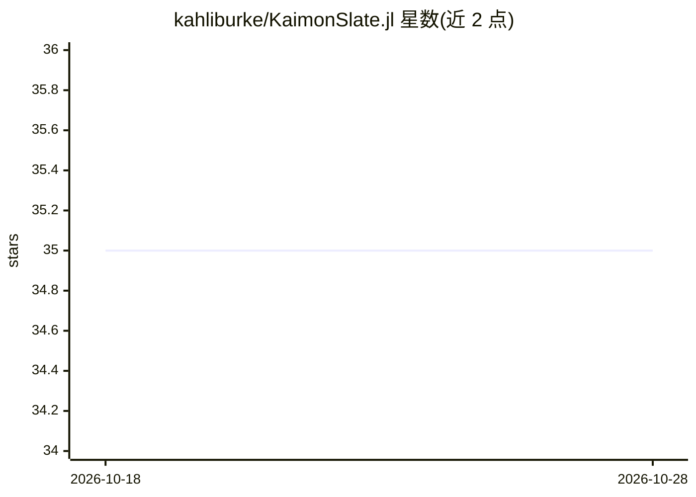

# kahliburke/KaimonSlate.jl

⭐ 35 · Julia · MIT · 推送 2026-10-27 · [GitHub](https://github.com/kahliburke/KaimonSlate.jl) · [官网](https://kahliburke.github.io/KaimonSlate.jl/dev/) · 个人维护

**响应式 Julia notebook：单元格 DAG、跨机执行与 AI 助手**

基于响应式单元格的 Julia 笔记本：单元格构成依赖图，改动后仅下游单元格重算；单元格可标记 region 到远程机器（GPU 服务器/云 VM）执行，跨机数值经加密内容寻址通道自动传输；输出含 CairoMakie 图、ECharts 交互图与可排序表格；昂贵单元格按内容寻址做磁盘缓存；内置发布管理器支持 GitHub Pages/Netlify/S3 等目标并可导出 PDF/HTML/自包含 .jl；AI agent 将修改以普通单元格形式写入 .jl，可选 Claude 或本地模型运行，仅安装 Kaimon 时可用，standalone 模式无 AI agent。需 Julia 1.12+。

## 筛选速览

| 维度 | 判定 | 备注 |
|---|---|---|
| AI 角色 | `ai-enhanced` | 去掉 AI 部分产品仍成立 |
| 许可风险 | `permissive` | MIT |
| 部署形态 | `None` |  |
| 模型依赖 | — | README 未给出锁定关系 |
| 硬件要求 | — | 无带数字的原话,不猜 |
| 安装摩擦 | `low` | 无编译、无系统依赖或容器化 |
| 成熟度 | — | 结构信号不足 |

## 能力要点

- 单元格依赖图：仅下游重算，无隐藏内核状态
- 单元格可分发到远程机器执行，加密内容寻址通道传值
- 内容寻址磁盘缓存与时间线回放历史运行状态
- 发布为网站并导出 PDF/HTML/自包含 .jl（含环境与 git 历史）

## 适用场景

- 在本地交互而把重计算单元放到 GPU 服务器或云 VM 上跑
- 用响应式笔记本文档化数据科学工作流并发布成网站
- 让 AI agent 以单元格形式增改控件、绘图或重构流水线

## 场景标签

`编码 Agent` · 领域:编码与开发

## 证据(README 行号)

> L10: A reactive Julia notebook for ambitious work. Cells can run across several machines, large live output stays intera
> L34: The agent edits the notebook by writing cells into the same `.jl` you edit. Ask it to add a control, draw a plot, o
> L114: - **With Kaimon** — per-notebook workers, each pinned to the notebook's Julia project, plus the AI agent's `slate.

## 星数曲线

2026-10-18 35 → 2026-10-28 35（+0）

---
*卡片 v1 · prompt 1.4 · 生成 2026-10-25 · 置信度 high · 依据 README sha `b057de533089` · [字段定义](../../DATASET.md)*
