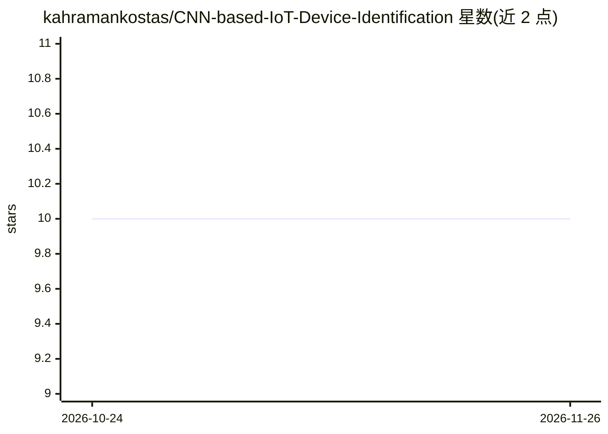

# kahramankostas/CNN-based-IoT-Device-Identification

⭐ 10 · Jupyter Notebook · 推送 2026-09-02 · [GitHub](https://github.com/kahramankostas/CNN-based-IoT-Device-Identification) · 个人维护 · 中文 README

**用 CNN 从流量指纹识别 IoT 设备的论文代码实现**

论文《CNN based IoT Device Identification》的 Python 实现：对 Aalto 数据集中 IoT 设备的抓包数据提取指纹，用卷积神经网络做多类分类，实现设备识别以辅助发现安全漏洞。使用 Wireshark/tshark 与 Scapy 处理 pcap，Keras 构建模型，处理后的数据集随仓库共享。列出 Python 3.10+ 及依赖库要求，并给出实验所用计算机的技术规格。作者个人维护，MIT 许可，附论文引用信息。

## 筛选速览

| 维度 | 判定 | 备注 |
|---|---|---|
| AI 角色 | `ai-native` | 本体是模型或模型工具 |
| 许可风险 | `none` | — |
| 部署形态 | `None` |  |
| 模型依赖 | — | README 未给出锁定关系 |
| 硬件要求 | — | 无带数字的原话,不猜 |
| 安装摩擦 | `low` | 无编译、无系统依赖或容器化 |
| 成熟度 | — | 结构信号不足 |

## 能力要点

- 基于 Aalto 数据集 31 个良性 IoT 设备抓包数据的指纹提取
- CNN 多类分类的 Python 实现（Keras）
- 处理后数据集随仓库共享，原始数据集附地址

## 适用场景

- 复现论文中的 IoT 设备识别实验
- 对网络抓包中的设备做分类识别研究

## 场景标签

`网络安全` · 领域:学习与行业

## 证据(README 行号)

> L4: In this repository you will find a Python implementation of the methods in the paper CNN based IoT Device Identifica
> L8: While the use of the Internet of Things is becoming more and more popular, many security vulnerabilities are emergin

## 星数曲线

2026-10-24 10 → 2026-11-26 10（+0）

---
*卡片 v1 · prompt 1.4 · 生成 2026-11-19 · 置信度 high · 依据 README sha `408fcfb99fdc` · [字段定义](../../DATASET.md)*
