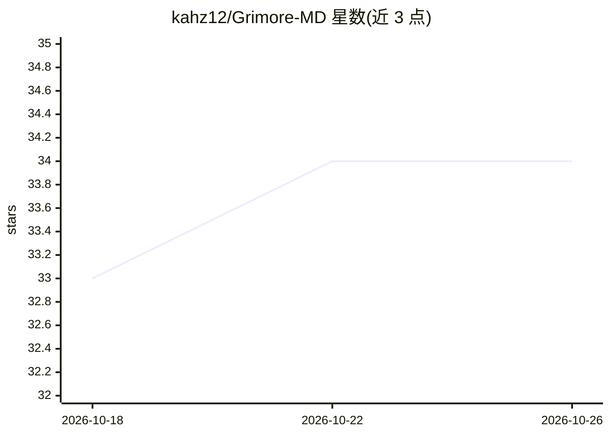

# kahz12/Grimore-MD

⭐ 34 · Python · MIT · 推送 2026-10-24 · [GitHub](https://github.com/kahz12/Grimore-MD) · 个人维护

**本地优先的知识库守护进程：自动索引打标并问答你的文档库**

用 Python 编写的本地优先认知守护进程，监控 Markdown/PDF/EPUB/DOCX/ODT/RTF/HTML/TXT 格式的文档库，通过本地 LLM 自动打标签、摘要、归入层级分类，构建 BM25 与向量余弦混合检索索引（RRF 融合），并以带引文方式回答问题。提供交互 shell、只读 MCP、HTTP API 与浏览器 UI、Obsidian 插件（0.1.1 手动安装）及图导出。默认要求 Ollama 的对话与嵌入模型，也可切换到 OpenAI 兼容后端（llama.cpp server、vLLM、LM Studio、OpenRouter、OpenAI）。隐私上默认拒绝非回环 LLM 端点，破坏性操作默认 dry-run。需 Python 3.11+ 与 git 初始化的库，支持 Linux/Windows/Termux。

## 筛选速览

| 维度 | 判定 | 备注 |
|---|---|---|
| AI 角色 | `ai-native` | 本体是模型或模型工具 |
| 许可风险 | `permissive` | MIT |
| 部署形态 | `None` |  |
| 模型依赖 | local-ok | 支持本地模型 |
| 硬件要求 | — | 无带数字的原话,不猜 |
| 安装摩擦 | `low` | 无编译、无系统依赖或容器化 |
| 成熟度 | — | 结构信号不足 |

## 能力要点

- 本地 LLM 自动打标、摘要、层级分类与混合语义索引
- Oracle 带引文问答，引文可定位到 PDF 页码/标题（如 [[Title#p.42]]）
- 多表面：交互 shell、MCP、HTTP API、Obsidian 插件、图导出
- 默认拒绝非回环 LLM 端点、破坏性操作默认 dry-run 的本地优先隐私模型

## 适用场景

- 给 Obsidian 等个人笔记库做自动索引、打标与分类
- 对自己混合格式的文档库提问并获得带出处的回答
- 在不联网、不出本机的前提下运行 RAG 知识引擎

## 场景标签

`知识库管理` `RAG` `文档问答` · 领域:知识与检索

## 证据(README 行号)

> L14: Grimore watches your vault — **Markdown, PDF, EPUB, DOCX, ODT, RTF, HTML, TXT** — auto-tags every document, builds 
> L26: Type a question, the Oracle streams back an answer with citations into your own notes.

## 星数曲线

2026-10-18 33 → 2026-10-26 34（+1）

---
*卡片 v1 · prompt 1.4 · 生成 2026-10-25 · 置信度 high · 依据 README sha `6ce150eaf605` · [字段定义](../../DATASET.md)*
