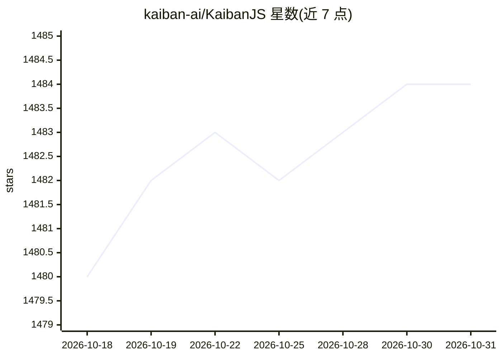

# kaiban-ai/KaibanJS

⭐ 1,484 · TypeScript · MIT · 推送 2026-05-15 · [GitHub](https://github.com/kaiban-ai/KaibanJS) · [官网](https://www.kaibanjs.com/) · 组织维护

**JavaScript 原生多智能体系统构建框架，Kanban 式任务编排**

面向 JavaScript 开发者的多智能体（multi-agent）框架：以 Agent、Task、Team 为核心概念，采用 Kanban 看板方式编排与可视化 AI 工作流，实时跟踪任务从 To Do 到 Done 的流转。支持角色化 Agent 设计、LangChainJS 兼容工具集成、任务结果传递、团队级记忆管理、多 LLM 接入、Redux 式状态管理、可观测性（token 用量与成本统计），以及不依赖 LLM 推理的 WorkflowDrivenAgent。通过 npm 安装，附 Kaiban Board 可视化界面，可集成 React/Vue/Angular/NextJS/Node.js，也可无 UI 运行。

## 筛选速览

| 维度 | 判定 | 备注 |
|---|---|---|
| AI 角色 | `ai-ecosystem` | LLM/agent 周边工具 |
| 许可风险 | `permissive` | MIT |
| 部署形态 | `library` | 以包/库形式分发 |
| 模型依赖 | — | README 未给出锁定关系 |
| 硬件要求 | — | 无带数字的原话,不猜 |
| 安装摩擦 | `low` | 无编译、无系统依赖或容器化 |
| 成熟度 | `idea` | |

## 能力要点

- Agent/Task/Team 核心抽象与 Kanban 看板实时可视化
- 支持 LangChainJS 兼容工具集成与任务结果自动传递
- 多 LLM 接入与团队级记忆管理
- WorkflowDrivenAgent 支持无 LLM 调用的确定性工作流，可挂起/恢复

## 适用场景

- 在 React/Node.js 项目中编排多智能体协作完成研究、写作等流程
- 通过 Kaiban Board 实时观察智能体任务进度与结果
- 用外部编码 CLI（Claude Code/OpenCode/Codex）作为智能体后端执行任务

## 场景标签

`Agent 框架` `多智能体` · 领域:Agent 开发

## 证据(README 行号)

> L4:  The JavaScript Framework for Building Multi-agent Systems.
> L34: - 🔨 Create, visualize, and manage AI agents, tasks, tools, and teams
> L192:  Multiple LLMs Support

## 星数曲线

2026-10-18 1,480 → 2026-10-31 1,484（+4）

---
*卡片 v1 · prompt 1.4 · 生成 2026-10-21 · 置信度 high · 依据 README sha `9f8ce76e0289` · [字段定义](../../DATASET.md)*
