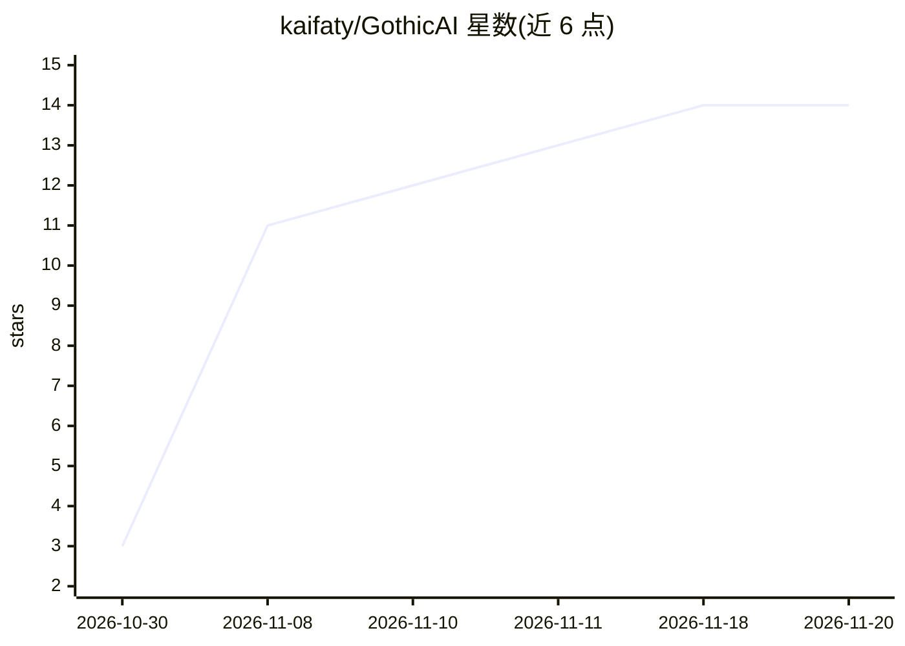

# kaifaty/GothicAI

⭐ 14 · Python · MIT · 推送 2026-11-19 · [GitHub](https://github.com/kaifaty/GothicAI) · [官网](https://kaifaty.github.io/GothicAI/) · 个人维护

**给哥特2重制版加 AI 语音 NPC 对话的开源项目**

基于 OpenGothic 引擎改造的 Gothic II 夜鸦版，NPC 由语言模型驱动：按住按键即可语音对话，36 个剧情角色用克隆的原版俄语配音回答，NPC 有记忆、信念与日常安排，谎言在揭穿前生效，导演系统随游玩生成新任务。架构上引擎内的小桥连接旁路 AI 服务器，快慢双模型分工。状态为早期实验：macOS 需源码构建，Windows/Linux 有预构建包但未经真机验证，需自备俄语原版游戏、ChatGPT 订阅与 Inworld API key。

## 筛选速览

| 维度 | 判定 | 备注 |
|---|---|---|
| AI 角色 | `ai-enhanced` | 去掉 AI 部分产品仍成立 |
| 许可风险 | `permissive` | MIT |
| 部署形态 | `None` |  |
| 模型依赖 | — | README 未给出锁定关系 |
| 硬件要求 | — | 无带数字的原话,不猜 |
| 安装摩擦 | `low` | 无编译、无系统依赖或容器化 |
| 成熟度 | `idea` | |

## 能力要点

- 语音对话 NPC：语音识别、LLM 回复、克隆配音与口型手势同步
- NPC 记忆绑定存档分支，谎言与传闻在游戏内产生真实后果
- 导演系统按玩家行为追加任务、角色与隐藏挑战
- 引擎内运行的小型神经网络控制近战（--neural-body 开关）

## 适用场景

- 以语音与哥特2的 NPC 自由对话推进剧情
- 体验谎言、证人与传闻系统的 RPG 沙盒玩法
- 研究游戏引擎与 LLM 服务的桥接架构

## 场景标签

`语音 Agent` · 领域:对话与助手

## 证据(README 行号)

> L5: Это оригинальная игра на движке OpenGothic с нашими изменениями. За персонажами стоят языковые модели. Зажимаешь кла
> L89: - Игра — OpenGothic с нашими изменениями (`OpenGothic/`). Тонкий мост внутри движка говорит с ИИ-сервером (`server/
> L98: **Что нужно:** русская Gothic II Gold (с «Ночью Ворона»), подписка ChatGPT (мозг жителей), ключ API Inworld (распоз

## 星数曲线

2026-10-30 3 → 2026-11-20 14（+11）

---
*卡片 v1 · prompt 1.4 · 生成 2026-11-18 · 置信度 high · 依据 README sha `5f674f768381` · [字段定义](../../DATASET.md)*
