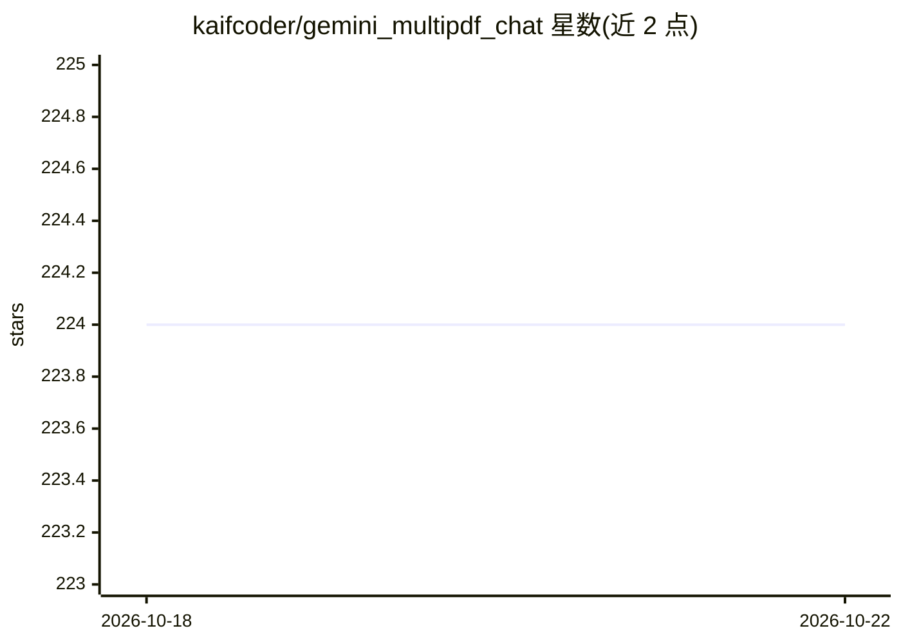

# kaifcoder/gemini_multipdf_chat

⭐ 224 · Python · MIT · 推送 2025-12-12 · [GitHub](https://github.com/kaifcoder/gemini_multipdf_chat) · [官网](https://gmultichat.streamlit.app/) · 个人维护

**基于 Gemini 的多 PDF 对话问答应用（Streamlit）**

Streamlit 网页应用：用户上传多个 PDF 文件，应用提取文本并生成嵌入，随后通过 Google Gemini 对话模型基于文档内容回答问题，提供聊天界面。使用需自行申请 Google API key 并写入 .env 文件。支持 Docker Compose 一键运行，或 Python 3.10+ 环境下 pip 安装依赖后以 streamlit run 启动，依赖 PyPDF2、LangChain、google.generativeai 等库。面向需要与 PDF 文档对话的终端用户。

## 筛选速览

| 维度 | 判定 | 备注 |
|---|---|---|
| AI 角色 | `ai-native` | 本体是模型或模型工具 |
| 许可风险 | `permissive` | MIT |
| 部署形态 | `self-host` | docker 或自建部署 |
| 模型依赖 | — | README 未给出锁定关系 |
| 硬件要求 | — | 无带数字的原话,不猜 |
| 安装摩擦 | `low` | 无编译、无系统依赖或容器化 |
| 成熟度 | — | 结构信号不足 |

## 能力要点

- 多 PDF 上传与文本提取
- Gemini 模型基于文档上下文回答问题
- 提供 Streamlit 聊天界面
- Docker Compose 一键运行

## 适用场景

- 上传多个 PDF 后针对内容提问获得回答
- 本地或云端部署文档问答对话应用

## 场景标签

 · 领域:LLM 应用/文档问答

## 证据(README 行号)

> L3: Gemini PDF Chatbot is a Streamlit-based application that allows users to chat with a conversational AI model trained
> L12: - **Conversational AI:** Uses the Gemini conversational AI model to answer user questions.

## 星数曲线

2026-10-18 224 → 2026-10-22 224（+0）

---
*卡片 v1 · prompt 1.4 · 生成 2026-10-22 · 置信度 high · 依据 README sha `9f2b5f4f8ae7` · [字段定义](../../DATASET.md)*
