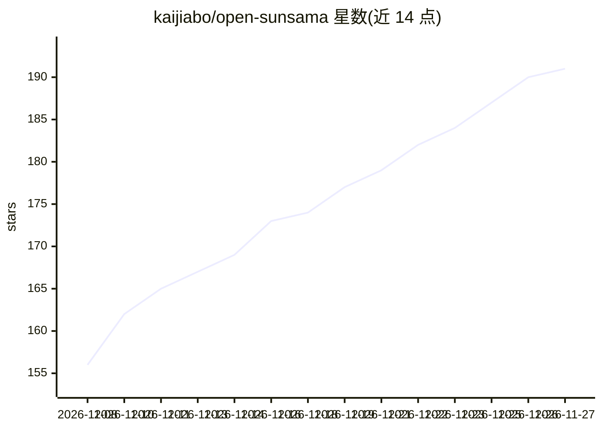

# kaijiabo/open-sunsama

⭐ 191 · TypeScript · NOASSERTION · 推送 2026-11-24 · [GitHub](https://github.com/kaijiabo/open-sunsama) · [官网](https://opensunsama.com) · 个人维护

**可被 AI 助手通过 MCP 控制的开源每日计划工具**

开源每日计划应用，提供看板式任务管理、日历时间块拖拽、专注计时模式、任务滚动与例行任务；通过一键 MCP 连接器（OAuth 2.1 + PKCE）让 Claude、ChatGPT、Cursor 等 MCP 客户端读写任务与日程，共暴露 47 个带注解的工具，另有 JWT/作用域 API key 的 REST API。支持云端使用与 Docker 自托管，提供 Web、桌面（macOS/Windows/Linux）应用，移动端处于早期构建阶段；自托管时桌面与移动应用仅连接官方云。

## 筛选速览

| 维度 | 判定 | 备注 |
|---|---|---|
| AI 角色 | `ai-enhanced` | 去掉 AI 部分产品仍成立 |
| 许可风险 | `none` | NOASSERTION |
| 部署形态 | `self-host` | docker 或自建部署 |
| 模型依赖 | locked-api |  |
| 硬件要求 | — | 无带数字的原话,不猜 |
| 安装摩擦 | `low` | 无编译、无系统依赖或容器化 |
| 成熟度 | — | 结构信号不足 |

## 能力要点

- 47 个 MCP 工具覆盖任务、时间块、想法板、子任务、档案管理
- OAuth 2.1 + PKCE 一键连接 Claude/ChatGPT，无 API key 配置
- REST API 提供作用域 key（tasks:read 等 8 个 scope）
- Docker Compose 一键自托管（PostgreSQL、Redis、API、Web）

## 适用场景

- 用 Claude/ChatGPT 对话式规划今天的任务和时间块
- 自托管计划工具并把数据留在自己服务器上
- 以专注计时模式跟踪任务实际用时与估算差距
- 与 Google Calendar/Outlook/iCloud 同步日程

## 场景标签

 · 领域:生产力/个人计划工具

## 证据(README 行号)

> L7: The open-source daily planner for time-blocking, focused work, and seamless AI integration.
> L26: - **🗓️ Sunsama-style daily planning.** A kanban board of days, drag-and-drop time blocking, focus mode with a timer
> L280: An open-source daily planner and task manager inspired by Sunsama. You plan each day on a kanban board, time-block

## 星数曲线

2026-11-08 156 → 2026-11-27 191（+35）

---
*卡片 v1 · prompt 1.4 · 生成 2026-11-26 · 置信度 high · 依据 README sha `e207f1fd0c27` · [字段定义](../../DATASET.md)*
