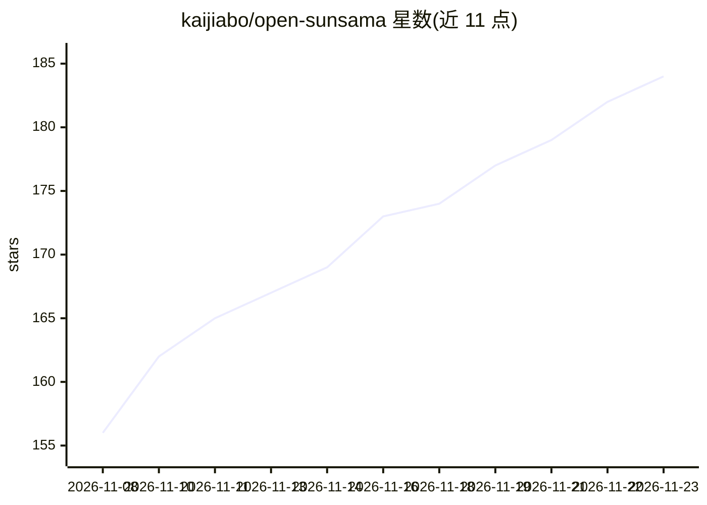

# kaijiabo/open-sunsama

⭐ 184 · TypeScript · NOASSERTION · 推送 2026-11-20 · [GitHub](https://github.com/kaijiabo/open-sunsama) · [官网](https://opensunsama.com) · 个人维护

**可被 Claude/ChatGPT 经 MCP 操控的开源自托管日计划工具**

受 Sunsama 启发的开源每日计划器：看板式日程、拖拽时间块、专注模式与番茄钟、想法看板、日历同步，提供 Web/桌面/移动端。AI 部分为 MCP 服务器（24 个工具，OAuth 2.1 一键连接），使 Claude、ChatGPT、Cursor、Claude Code 等 agent 可读写任务与时间块；另有带作用域的 REST API。自托管经 Docker Compose（含 PostgreSQL、Redis）或从源码运行（需 Bun 与 PostgreSQL 15+），桌面/移动端应用仅连接官方云端。团队工作区、Linear/GitHub/Jira 集成与 AI 自动排程在路线图中尚未完成。

## 筛选速览

| 维度 | 判定 | 备注 |
|---|---|---|
| AI 角色 | `ai-enhanced` | 去掉 AI 部分产品仍成立 |
| 许可风险 | `none` | NOASSERTION |
| 部署形态 | `self-host` | docker 或自建部署 |
| 模型依赖 | locked-api |  |
| 硬件要求 | — | 无带数字的原话,不猜 |
| 安装摩擦 | `low` | 无编译、无系统依赖或容器化 |
| 成熟度 | — | 结构信号不足 |

## 能力要点

- 24 个 MCP 工具覆盖任务、时间块、子任务与日历读取
- OAuth 2.1 一键连接 Claude/ChatGPT，无 API key，令牌按小时过期
- 带作用域的 REST API（JWT 或 X-API-Key）
- Docker Compose 自托管，Web/桌面/移动三端

## 适用场景

- 在看板和时间块上做每日计划并进入专注模式
- 让 Claude 或 ChatGPT 代为整理、排程和管理任务
- 团队在自有服务器上自托管计划器并保持数据可控

## 场景标签

 · 领域:生产力/任务管理

## 证据(README 行号)

> L7: The open-source daily planner for time-blocking, focused work, and seamless AI integration.
> L277: An open-source daily planner and task manager inspired by Sunsama. You plan each day on a kanban board, time-block

## 星数曲线

2026-11-08 156 → 2026-11-23 184（+28）

---
*卡片 v1 · prompt 1.4 · 生成 2026-11-17 · 置信度 high · 依据 README sha `7ade55078c50` · [字段定义](../../DATASET.md)*
