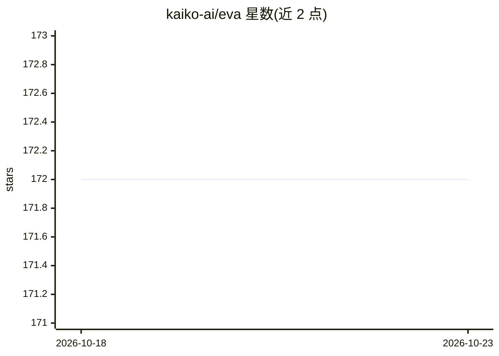

# kaiko-ai/eva

⭐ 172 · Python · Apache-2.0 · 推送 2026-09-02 · [GitHub](https://github.com/kaiko-ai/eva) · [官网](https://kaiko-ai.github.io/eva/) · 组织维护

**肿瘤学基础模型评测框架：病理/影像基准评测**

kaiko.ai 开发的肿瘤学基础模型评测框架，支持 patch/切片/扫描级别的分类、2D/3D 语义分割与 VQA 任务的标准化基准测试，提供离线与在线两种评测模式和多次运行的统计汇总。内置对常用医学数据集与模型的支持，通过 YAML 或 Python 配置，既可作为 Python 库使用也可作为 CLI 工具运行。仓库内含病理与放射方向的排行榜，安装经由 PyPI（kaiko-eva）或 GitHub 主分支。

## 筛选速览

| 维度 | 判定 | 备注 |
|---|---|---|
| AI 角色 | `ai-ecosystem` | LLM/agent 周边工具 |
| 许可风险 | `permissive` | Apache-2.0 |
| 部署形态 | `library` | 以包/库形式分发 |
| 模型依赖 | — | README 未给出锁定关系 |
| 硬件要求 | — | 无带数字的原话,不猜 |
| 安装摩擦 | `low` | 无编译、无系统依赖或容器化 |
| 成熟度 | — | 结构信号不足 |

## 能力要点

- 支持分类、2D/3D 语义分割与 VQA 任务的标准化基准评测
- 离线 + 在线评测模式，多次运行统计
- 内置对常用医学数据集与模型的支持
- YAML 或 Python 完全配置，CLI 与 Python 接口等价

## 适用场景

- 对病理/放射基础模型做标准化基准评测
- 比较多个肿瘤学基础模型并查看排行榜结果
- 在自己的医学数据集上复现或扩展评测流程

## 场景标签

`模型评测` · 领域:评测与运维

## 证据(README 行号)

> L17: _`eva`_ is an evaluation framework for oncology foundation models (FMs) by kaiko.ai.
> L21: - 🔬 Standardized benchmarking for oncology foundation models
> L22: - 🧠 Supports patch-level/slide-level/scan-level classification, 2D/3D semantic segmentation, and VQA tasks

## 星数曲线

2026-10-18 172 → 2026-10-23 172（+0）

---
*卡片 v1 · prompt 1.4 · 生成 2026-10-22 · 置信度 high · 依据 README sha `cac104e589d5` · [字段定义](../../DATASET.md)*
