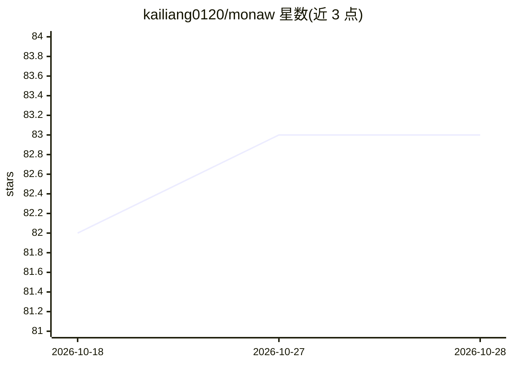

# kailiang0120/monaw

⭐ 83 · Python · Apache-2.0 · 推送 2026-10-25 · [GitHub](https://github.com/kailiang0120/monaw) · 个人维护

**Windows 开源 AI 桌面助手：聊天驱动文件、命令与浏览器自动化**

基于 Electron + React + Python(FastAPI) 的 Windows 桌面 AI 助手，面向终端用户。聊天界面连接一个自定义 agent 循环（更新上下文→调用模型→授权→执行→观察），可读写文件、运行 shell 命令、通过 Chrome DevTools MCP 控制用户 Chrome、用 pywinauto 控制 Windows 应用，并支持 MCP 工具接入、定时任务与 Telegram 远程下发。模型接入三通道：OpenAI API（Responses API）、ChatGPT 账号登录（Codex SDK）、Google Gemini API。数据与记忆存于本地（SQLite/Markdown），API key 经 Electron safeStorage 加密。仅支持 Windows 10/11，macOS 未测试；通过 clone 源码加 setup.bat/start.bat 运行，暂不接受外部贡献。

## 筛选速览

| 维度 | 判定 | 备注 |
|---|---|---|
| AI 角色 | `ai-native` | 本体是模型或模型工具 |
| 许可风险 | `permissive` | Apache-2.0 |
| 部署形态 | `desktop` | 安装包/桌面程序 |
| 模型依赖 | — | README 未给出锁定关系 |
| 硬件要求 | — | 无带数字的原话,不猜 |
| 安装摩擦 | `low` | 无编译、无系统依赖或容器化 |
| 成熟度 | — | 结构信号不足 |

## 能力要点

- agent 循环（上下文→模型→授权→执行→观察）带审批模式与沙箱策略
- 三种模型通道：OpenAI API / ChatGPT 账号（Codex SDK）/ Gemini API
- 本地优先存储：SQLite 会话、Markdown 记忆、safeStorage 加密密钥
- MCP 工具（stdio/Streamable HTTP）、定时任务、Telegram 远程任务

## 适用场景

- 用对话让 AI 读写项目文件、跑命令、操作 Windows 应用
- 自动化操作自己的 Chrome 浏览器完成网页任务
- 通过 Telegram 远程下发并接收 agent 任务结果
- 设置定时任务让 agent 周期性执行工作

## 场景标签

`AI 助手` `浏览器自动化` `GUI 自动化` · 领域:效率与自动化

## 证据(README 行号)

> L5: **An open-source AI desktop assistant for Windows, built with Electron, React, and Python.**
> L7: Monaw connects a chat interface to an agent that can work with project files, run commands, automate Chrome and Wind
> L9: The application runs on your PC. Chat history, settings, memory, and artifacts are stored locally; model requests go

## 星数曲线

2026-10-18 82 → 2026-10-28 83（+1）

---
*卡片 v1 · prompt 1.4 · 生成 2026-10-24 · 置信度 high · 依据 README sha `287a2c286845` · [字段定义](../../DATASET.md)*
