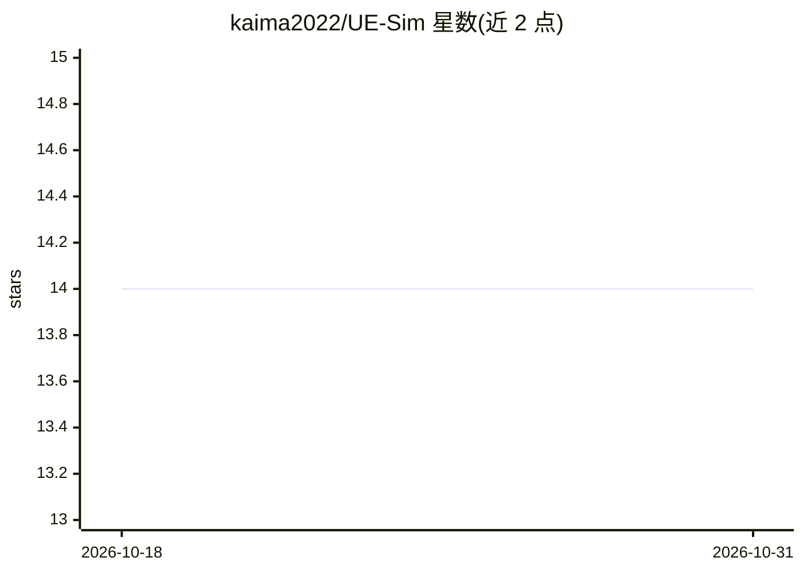

# kaima2022/UE-Sim

⭐ 14 · C++ · GPL-2.0 · 推送 2026-04-21 · [GitHub](https://github.com/kaima2022/UE-Sim) · [官网](https://kaima2022.github.io/UE-Sim/) · 组织维护 · 中文 README

**面向科研的 Ultra Ethernet 端到端网络仿真平台（基于 ns-3）**

基于 ns-3（3.44）实现的 Ultra Ethernet（UE）规范端到端网络仿真平台，面向 GPU 厂商、AI 数据中心运营者与协议研究人员。核心实现 SES（事务语义子层，含分片/重组与 MSN 管理）、PDS（包分发调度与拥塞控制协调）、PDC（IPDC 不可靠低时延与 TPDC 可靠重传两种传输上下文）。用户可构建不同规模拓扑、配置参数并在多种负载下评估网络性能，或用于协议验证与规范优化。支持构建拓扑、配置参数、跑通带注释日志的概念演示。需 Linux/macOS 下从源码编译（GCC 10.1+/CMake），GPLv2 许可，v1.0.0 初版发布。

## 筛选速览

| 维度 | 判定 | 备注 |
|---|---|---|
| AI 角色 | `ai-ecosystem` | LLM/agent 周边工具 |
| 许可风险 | `viral` | GPL-2.0 |
| 部署形态 | `None` |  |
| 模型依赖 | — | README 未给出锁定关系 |
| 硬件要求 | — | 无带数字的原话,不猜 |
| 安装摩擦 | `medium` | 含编译或系统依赖之一 |
| 成熟度 | — | 结构信号不足 |

## 能力要点

- 基于 ns-3 3.44 实现 SES/PDS/PDC 三层 UE 协议栈
- 支持 IPDC（不可靠低时延）与 TPDC（可靠重传/RTO）两种传输上下文
- 提供概念演示程序、examples 教程与 benchmarks 性能验证目录
- 面向 AI/HPC 数据中心网络研究与 Ultra Ethernet 规范验证

## 适用场景

- AI/HPC 数据中心网络在不同拓扑与负载下的性能评估
- Ultra Ethernet 协议算法创新与规范优化研究
- 学习 UE 协议栈 SES/PDS/PDC 分层交互的端到端演示

## 场景标签

`科研工具` · 领域:学习与行业

## 证据(README 行号)

> L10: UE-Sim is an Ultra Ethernet network simulator based on ns-3 for AI and HPC data center network research, protocol v
> L32: - **Network Configuration and Performance Evaluation**: UE-Sim provides an Ultra Ethernet simulation platform for G
> L34: - **Ultra Ethernet (UE) Specification Optimization**: The platform enables researchers to optimize the Ultra Ethern

## 星数曲线

2026-10-18 14 → 2026-10-31 14（+0）

---
*卡片 v1 · prompt 1.4 · 生成 2026-10-31 · 置信度 high · 依据 README sha `1c016a8e0acf` · [字段定义](../../DATASET.md)*
