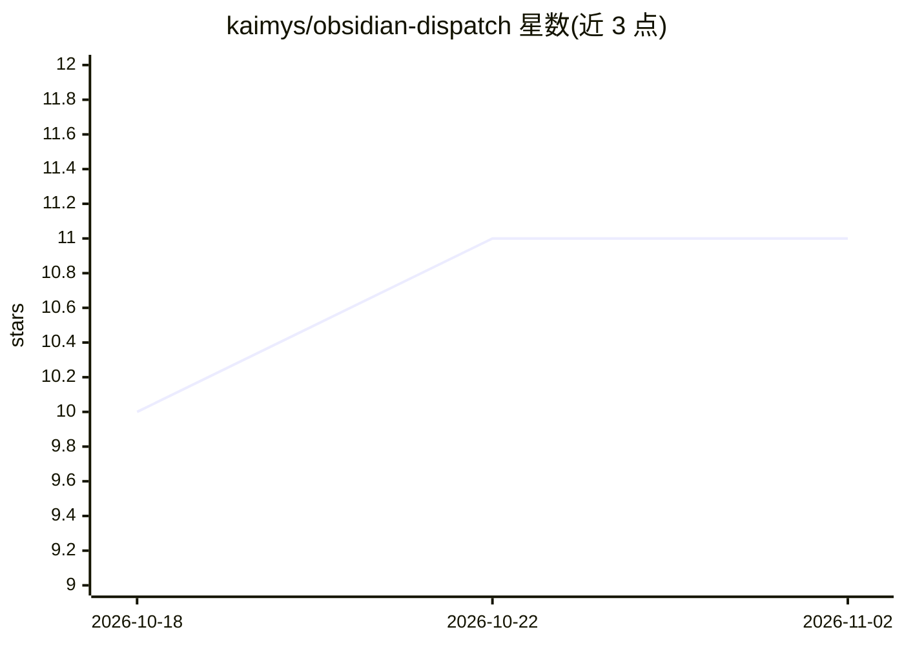

# kaimys/obsidian-dispatch

⭐ 11 · TypeScript · MIT · 推送 2026-10-14 · [GitHub](https://github.com/kaimys/obsidian-dispatch) · [官网](https://community.obsidian.md/plugins/dispatch) · 个人维护

**Obsidian 看板插件：将编码 agent 派发到 wiki 工单上**

Obsidian 桌面端看板插件，面向使用编码 agent 的小团队：工单即笔记，看板是 frontmatter 的实时视图，每张卡片可通过 chip 启动编码 agent（Claude Code、Codex 或任意 CLI）带着工单上下文进入对应仓库。提供评审（Slack via MCP 团队问答回流）、发布计划拖拽、会议纪要转录入库与测试核查徽章等流程；工作流为单文件存于代码仓库。要求 Obsidian 桌面版 1.7.2+、agent CLI 与 Node.js 18+，无移动版；看板本身不依赖 Node。

## 筛选速览

| 维度 | 判定 | 备注 |
|---|---|---|
| AI 角色 | `ai-ecosystem` | LLM/agent 周边工具 |
| 许可风险 | `permissive` | MIT |
| 部署形态 | `None` |  |
| 模型依赖 | — | README 未给出锁定关系 |
| 硬件要求 | — | 无带数字的原话,不猜 |
| 安装摩擦 | `low` | 无编译、无系统依赖或容器化 |
| 成熟度 | — | 结构信号不足 |

## 能力要点

- 卡片 chip 一键启动编码 agent（Claude Code/Codex/任意 CLI），运行前展示确切命令
- 评审问题经 Slack MCP 发团队群，答案回流工单规格
- 会议转录自动生成报告并折算决议到相关工单
- 每个工作流单文件 + 每 agent 薄 stub，多 agent 共享同一流程

## 适用场景

- 团队以 wiki 看板管理工单并派发编码 agent 执行
- 通过团队聊天完成工单评审并把答案写回规格
- 拖拽规划发布版本并查看加权进度与速度预测

## 场景标签

`编码 Agent` · 领域:编码与开发

## 证据(README 行号)

> L10: **Dispatch is a board for Obsidian that gives a small agent-native team a working
> L22: - **Agent skills and MCP are the glue.** Chips on the board are one-liners (`/refine US00042`); the workflow logic 
> L24: Under the hood, two primitives: **boards** (kanban views driven by note properties — drag & drop writes frontmatter

## 星数曲线

2026-10-18 10 → 2026-11-02 11（+1）

---
*卡片 v1 · prompt 1.4 · 生成 2026-11-02 · 置信度 high · 依据 README sha `c426ad5a262c` · [字段定义](../../DATASET.md)*
