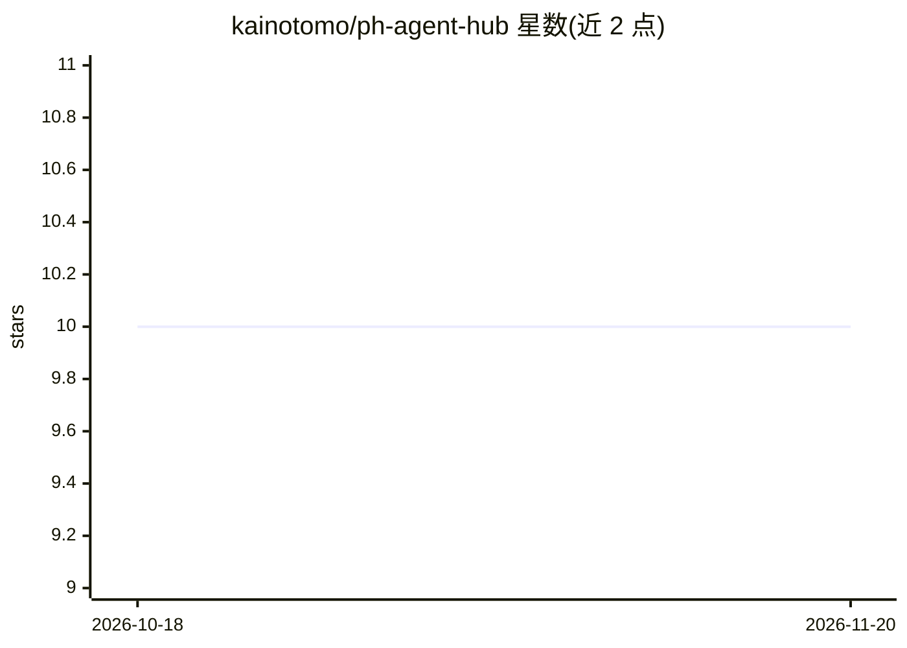

# kainotomo/ph-agent-hub

⭐ 10 · Python · MIT · 推送 2026-11-16 · [GitHub](https://github.com/kainotomo/ph-agent-hub) · [官网](https://kainotomo.com/ph-agent-hub) · 组织维护

**给团队用的多租户 AI 平台：聊天界面+模型/租户管理后台**

基于 FastAPI + React 的多租户 AI 应用平台，采用 Microsoft Agent Framework 做运行时编排。提供面向终端用户的 Chat UI 与面向运营的 Admin UI（模型、工具、租户、用户与治理），租户隔离落在授权与数据层。内置 DeepSeek 稳定化层（推理剥离、JSON 修复、重试编排）与可嵌入网站的聊天 Widget，支持匿名访客流程。Docker Compose 一键部署，MIT 许可免费版限 3 个租户，另有付费 Pro 与云托管版本。

## 筛选速览

| 维度 | 判定 | 备注 |
|---|---|---|
| AI 角色 | `ai-ecosystem` | LLM/agent 周边工具 |
| 许可风险 | `permissive` | MIT |
| 部署形态 | `self-host` | docker 或自建部署 |
| 模型依赖 | locked-api |  |
| 硬件要求 | — | 无带数字的原话,不猜 |
| 安装摩擦 | `low` | 无编译、无系统依赖或容器化 |
| 成熟度 | — | 结构信号不足 |

## 能力要点

- 双界面：终端用户 Chat UI + 管理员 Admin 控制面
- 后端授权与数据层的多租户隔离
- DeepSeek 稳定化层：reasoning strip、JSON 修复、重试编排
- 支持 A2A 协议：作为客户端调用外部 agent，也以 Agent Card 对外暴露

## 适用场景

- 构建租户隔离的 AI SaaS 或内部多业务线 copilot
- 按租户配置模型与工具，避免逐客户硬编码
- 需要用量统计、审计日志与角色控制的运营场景
- 在官网嵌入聊天 Widget 供匿名访客使用

## 场景标签

`聊天机器人` `AI 助手` · 领域:对话与助手

## 证据(README 行号)

> L22: PH Agent Hub is a multi-tenant AI application platform for teams that need both:
> L24: - an operational admin control plane for models, tools, tenancy, and governance
> L26: It is built on FastAPI + React and uses the Microsoft Agent Framework for agent runtime orchestration.

## 星数曲线

2026-10-18 10 → 2026-11-20 10（+0）

---
*卡片 v1 · prompt 1.4 · 生成 2026-11-19 · 置信度 high · 依据 README sha `d5b2746fc978` · [字段定义](../../DATASET.md)*
