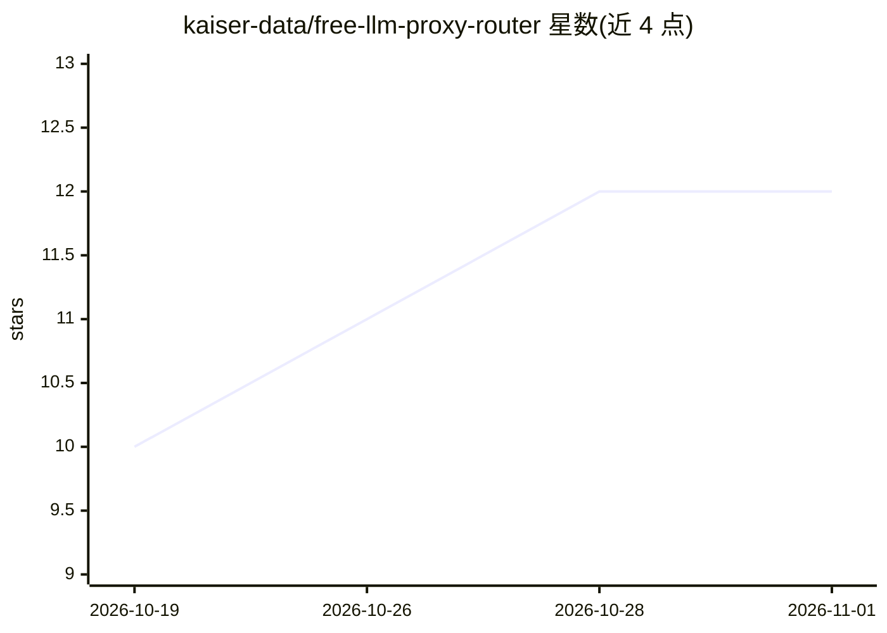

# kaiser-data/free-llm-proxy-router

⭐ 12 · Go · MIT · 推送 2026-10-31 · [GitHub](https://github.com/kaiser-data/free-llm-proxy-router) · 组织维护

**Go 单二进制免费 LLM 代理路由器：聚合各家免费额度为一个 OpenAI 兼容端点**

用 Go 编写的本地代理服务器，将多家提供商的免费层（OpenRouter、Groq、Gemini、Cerebras、GitHub Models、Ollama 等 10 家）聚合为 localhost:8080 上的单一 OpenAI 兼容端点。请求按 13 种路由策略选择模型，遇 429 限流时经 5 级回退链自动切换提供商并对限流方设置冷却；免费模型目录通过扫描提供商 API 自动发现。附带 catalog 扫描与 benchmark 两个辅助二进制。面向想在脚本、agent、homelab 或 CI 中获得免费推理而不部署大型网关的开发者，需自备至少一个 API key。

## 筛选速览

| 维度 | 判定 | 备注 |
|---|---|---|
| AI 角色 | `ai-ecosystem` | LLM/agent 周边工具 |
| 许可风险 | `permissive` | MIT |
| 部署形态 | `None` |  |
| 模型依赖 | local-ok | 支持本地模型 |
| 硬件要求 | — | 无带数字的原话,不猜 |
| 安装摩擦 | `low` | 无编译、无系统依赖或容器化 |
| 成熟度 | — | 结构信号不足 |

## 能力要点

- 单一 OpenAI 兼容端点聚合 10 家免费层提供商
- 5 级自动回退链与 429 冷却机制
- 13 种路由策略（speed/volume/coding/long_context 等）
- 免费模型目录由扫描提供商 API 自动发现，每周刷新

## 适用场景

- 让 aider、Cline、Open WebUI 等工具用免费模型额度持续工作
- 脚本或 CI 中避免免费额度限流中断
- 树莓派/NAS/低配 VPS 上运行轻量 LLM 代理

## 场景标签

`模型网关` · 领域:Agent 开发

## 证据(README 行号)

> L9: Point any OpenAI-compatible tool at `localhost:8080`. When Groq hits its rate limit, the request moves to Gemini, th
> L33: - **Single endpoint** at `localhost:8080` — drop-in replacement for the OpenAI API
> L35: - **Falls back** automatically when a provider is rate-limited or unavailable

## 星数曲线

2026-10-19 10 → 2026-11-01 12（+2）

---
*卡片 v1 · prompt 1.4 · 生成 2026-11-01 · 置信度 high · 依据 README sha `96697429ed27` · [字段定义](../../DATASET.md)*
