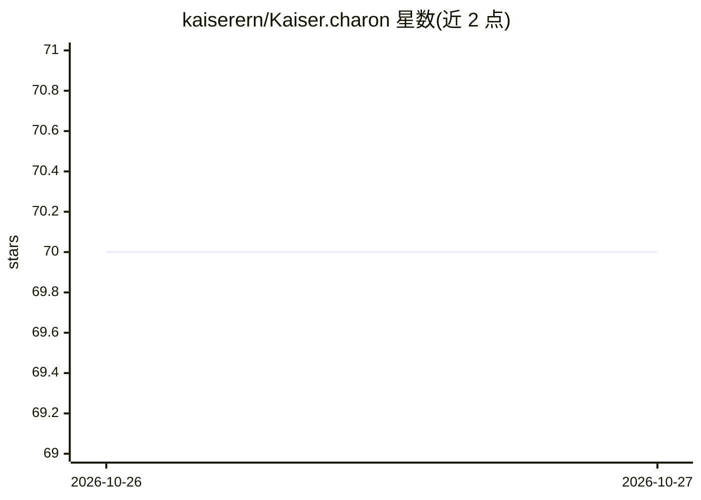

# kaiserern/Kaiser.charon

⭐ 70 · JavaScript · 推送 2026-10-25 · [GitHub](https://github.com/kaiserern/Kaiser.charon) · 个人维护

**Solana pump.fun 交易机器人：Telegram 筛选代币并经 Jupiter 执行**

yunus-0x/charon 的 fork，Node.js 编写的 Telegram 交易机器人：从 Signal Server 与 PumpPortal WebSocket 接收 pump.fun 代币信号，经 FLOW 过滤器与流动性门槛筛选后通过 Jupiter 执行买卖，支持 dry_run（SQLite 纸面成交）、confirm（Telegram 批准）与 live（真实交易）三种模式。LLM 入场选择为可选子系统（默认关闭，走规则路径）。策略参数存于 SQLite 可热读，Telegram 内调参；含回测工具与 29 个离线测试。需 Node.js 20+ 与原生编译依赖。

## 筛选速览

| 维度 | 判定 | 备注 |
|---|---|---|
| AI 角色 | `ai-enhanced` | 去掉 AI 部分产品仍成立 |
| 许可风险 | `none` | — |
| 部署形态 | `library` | 以包/库形式分发 |
| 模型依赖 | — | README 未给出锁定关系 |
| 硬件要求 | — | 无带数字的原话,不猜 |
| 安装摩擦 | `medium` | 含编译或系统依赖之一 |
| 成熟度 | — | 结构信号不足 |

## 能力要点

- 信号→富化→过滤→评分→决策→持仓的流水线，三种交易模式
- fill-to-fill 纸面成交使用可执行 Jupiter 报价而非合成标记价
- 策略参数存 SQLite 支持热读，Telegram /menu 在线调参
- 可选 LLM 入场选择子系统（use_llm 默认 false）

## 适用场景

- 在 dry_run 模式下用纸面成交跟踪 pump.fun 代币策略
- 通过 Telegram 接收候选报告并批准/拒绝交易
- 对比过滤器改动前后的本地交易历史回测结果

## 场景标签

 · 领域:加密货币/DeFi 交易

## 证据(README 行号)

> L8: A Telegram bot that screens Solana pump.fun tokens, filters them through a strategy, optionally asks an LLM to pick 
> L24: |**LLM**|off (`use_llm=false`) — decisions are rule-based|

## 星数曲线

2026-10-26 70 → 2026-10-27 70（+0）

---
*卡片 v1 · prompt 1.4 · 生成 2026-10-27 · 置信度 mid · 依据 README sha `0deb1e40fcfa` · [字段定义](../../DATASET.md)*
