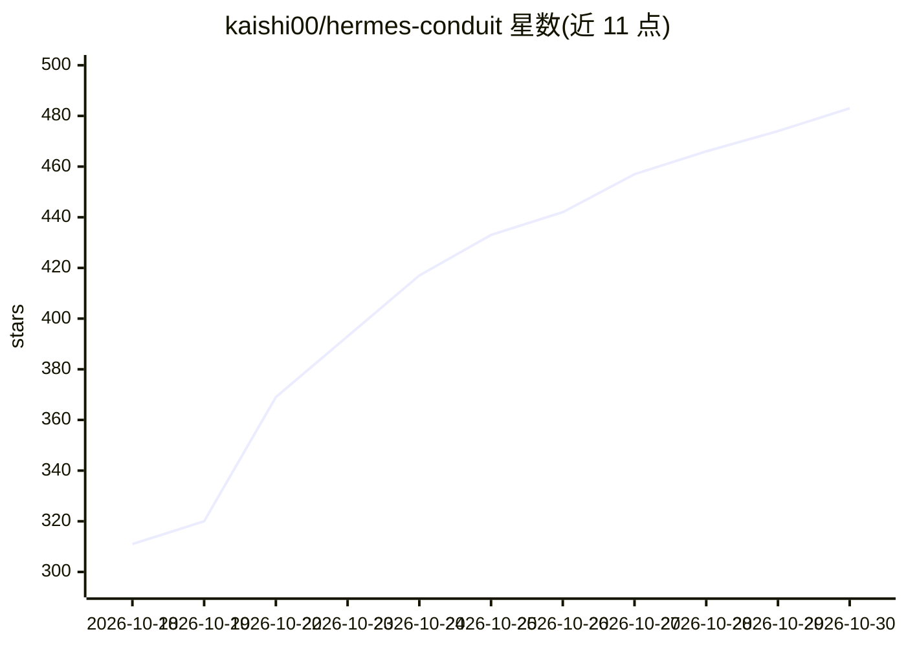

# kaishi00/hermes-conduit

⭐ 483 · Swift · MIT · 推送 2026-10-29 · [GitHub](https://github.com/kaishi00/hermes-conduit) · [官网](https://hermesconduit.app) · 个人维护

**Hermes Agent 的原生 iOS 客户端：手机上管理对话与任务**

用 SwiftUI 编写的 iPhone/iPad/Apple Watch 应用，通过登录用户自托管的 Hermes Agent 原生 dashboard（默认端口 9119）实现移动端访问：会话、配置、机器人、工具与定时任务与桌面端共用同一数据库。功能包括流式聊天、实时语音通话（Gemini Live/GPT-Live/Grok Live/本地语音服务）、任务看板、通知审批、Live Activities 与桌面小组件；可选的免费 Notifier 插件解锁通知、语音与手机能力（定位/日历/健康等，端到端加密且默认关闭）。通过 App Store 分发，无需部署 Conduit 自身服务器。

## 筛选速览

| 维度 | 判定 | 备注 |
|---|---|---|
| AI 角色 | `ai-ecosystem` | LLM/agent 周边工具 |
| 许可风险 | `permissive` | MIT |
| 部署形态 | `self-host` | docker 或自建部署 |
| 模型依赖 | — | README 未给出锁定关系 |
| 硬件要求 | — | 无带数字的原话,不猜 |
| 安装摩擦 | `low` | 无编译、无系统依赖或容器化 |
| 成熟度 | — | 结构信号不足 |

## 能力要点

- 登录自托管 Hermes dashboard，与桌面端共用同一会话数据库
- 实时语音通话支持 Gemini Live、GPT-Live、Grok Live 与本地语音服务
- 通知内直接审批工具调用，端到端加密
- 可选 Notifier 插件解锁通知、语音与定位/日历/健康等手机能力

## 适用场景

- 在手机上继续桌面端与自托管 AI agent 的对话
- 通过语音或 Apple Watch 操作 Hermes 任务与定时作业
- 远程审批 agent 的工具调用并接收推送通知

## 场景标签

`聊天机器人` `语音 Agent` · 领域:对话与助手

## 证据(README 行号)

> L3: A native iPhone, iPad and Apple Watch app for Hermes Agent. Free, no ads, no tracking.
> L11: Conduit is a touch-first app for your own Hermes agent on iPhone, iPad and Apple Watch, with CarPlay, widgets and L

## 星数曲线

2026-10-18 311 → 2026-10-30 483（+172）

---
*卡片 v1 · prompt 1.4 · 生成 2026-10-21 · 置信度 mid · 依据 README sha `65280072db57` · [字段定义](../../DATASET.md)*
