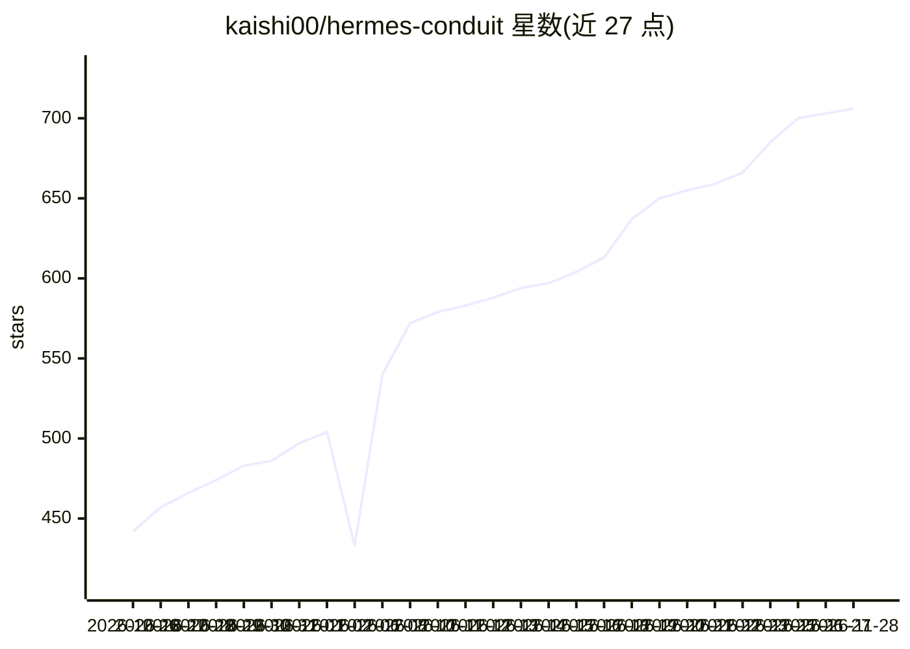

# kaishi00/hermes-conduit

⭐ 706 · Swift · MIT · 推送 2026-11-27 · [GitHub](https://github.com/kaishi00/hermes-conduit) · [官网](https://hermesconduit.app) · 个人维护

**自托管 Hermes Agent 的原生 iOS/Apple Watch 客户端**

面向运行自托管 Hermes Agent 的用户，提供 iPhone、iPad 与 Apple Watch 原生客户端：流式聊天、工具调用审批、语音实时通话（多种 Live 语音模式）、定时任务与看板任务管理、群聊机器人房间、Artifacts 文件浏览，以及位置/日历/健康等手机能力授权。客户端连接用户自己运行的 Hermes dashboard，通知与语音等增强功能需在主机安装免费的 Notifier 插件；通过 App Store 或 TestFlight 分发，另有 Mac/Windows/Linux 桌面版。

## 筛选速览

| 维度 | 判定 | 备注 |
|---|---|---|
| AI 角色 | `ai-ecosystem` | LLM/agent 周边工具 |
| 许可风险 | `permissive` | MIT |
| 部署形态 | `self-host` | docker 或自建部署 |
| 模型依赖 | — | README 未给出锁定关系 |
| 硬件要求 | — | 无带数字的原话,不猜 |
| 安装摩擦 | `low` | 无编译、无系统依赖或容器化 |
| 成熟度 | — | 结构信号不足 |

## 能力要点

- 原生 SwiftUI 应用覆盖 iPhone、iPad、Apple Watch，支持 CarPlay 与小组件
- 实时语音通话支持 Gemini Live、Qwen Live、GPT-Live、Grok Live 与本地语音服务器
- 工具调用可在通知或 Apple Watch 上直接审批，端到端加密
- 多设备共享同一 dashboard 会话与数据库

## 适用场景

- 在手机和手表上与自托管的 Hermes Agent 对话和派任务
- 通过语音通话让 agent 执行任务并回收结果
- 在通知里一键批准 agent 的工具调用
- 多人把各自的 bot 拉进同一房间协作

## 场景标签

`AI 助手` `聊天机器人` · 领域:对话与助手

## 证据(README 行号)

> L6: A native iPhone, iPad and Apple Watch app for Hermes Agent. Free, no ads, no tracking.
> L32: Conduit is a touch-first app for your own Hermes agent on iPhone, iPad and Apple Watch, with CarPlay, widgets and L
> L34: The app works with any Hermes dashboard on its own. The free Hermes Conduit Notifier plugin on your host adds notif

## 星数曲线

2026-10-26 442 → 2026-11-28 706（+264）

---
*卡片 v1 · prompt 1.4 · 生成 2026-11-28 · 置信度 high · 依据 README sha `301eeee8f4be` · [字段定义](../../DATASET.md)*
