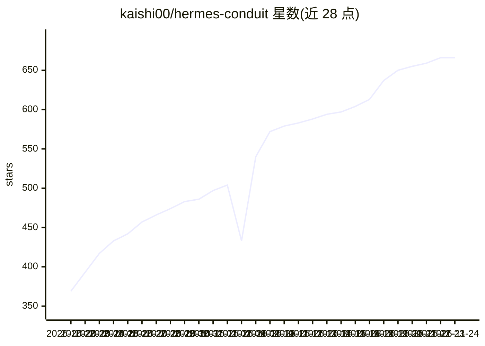

# kaishi00/hermes-conduit

⭐ 685 · Swift · MIT · 推送 2026-11-24 · [GitHub](https://github.com/kaishi00/hermes-conduit) · [官网](https://hermesconduit.app) · 个人维护

**自托管 Hermes Agent 的原生 iOS/iPadOS/Watch 客户端**

面向自托管 Hermes Agent 的原生 SwiftUI 应用，覆盖 iPhone、iPad 与 Apple Watch。用户登录自己运行的 Hermes dashboard，沿用桌面端的会话、profiles、bots、工具与定时任务。功能包括流式聊天（Markdown/Mermaid/diff/review 卡片）、与 Gemini/Qwen/Grok/ChatGPT 等的实时语音通话、Watch 通话与命令审批、任务看板、bots 群聊、Pulse 主动提醒，以及位置/日历/健康等手机数据（默认关闭、端到端加密）。通知、语音、Watch 等功能需在主机安装免费的 Notifier 插件。通过 App Store 与 TestFlight 分发。

## 筛选速览

| 维度 | 判定 | 备注 |
|---|---|---|
| AI 角色 | `ai-native` | 本体是模型或模型工具 |
| 许可风险 | `permissive` | MIT |
| 部署形态 | `self-host` | docker 或自建部署 |
| 模型依赖 | — | README 未给出锁定关系 |
| 硬件要求 | — | 无带数字的原话,不猜 |
| 安装摩擦 | `low` | 无编译、无系统依赖或容器化 |
| 成熟度 | — | 结构信号不足 |

## 能力要点

- 登录自托管 Hermes dashboard，与桌面端共享同一会话数据库
- 实时语音通话支持 Gemini Live、Qwen Live、Grok Live、GPT-Live 与本地语音服务器
- 通知内直接审批工具调用，主机与手机间端到端加密
- Watch 独立发起通话、审批命令，支持 CarPlay、Siri 与 Live Activities

## 适用场景

- 在手机上继续桌面端开始的 Hermes agent 会话
- 通过 Watch 或 CarPlay 语音调用 agent 并审批命令
- 定时任务完成后由 Hermes 回拨电话通知
- 在 bots 群聊中用 @mentions 协同多个 agent

## 场景标签

`聊天机器人` `语音 Agent` · 领域:对话与助手

## 证据(README 行号)

> L6: A native iPhone, iPad and Apple Watch app for Hermes Agent. Free, no ads, no tracking.
> L29: Conduit is a touch-first app for your own Hermes agent on iPhone, iPad and Apple Watch, with CarPlay, widgets and L
> L51: - Live voice calls with Gemini Live, Qwen Live, GPT-Live (ChatGPT subscription or API key), Grok Live, or Local Liv

## 星数曲线

2026-10-22 369 → 2026-11-24 666（+297）

---
*卡片 v1 · prompt 1.4 · 生成 2026-11-24 · 置信度 high · 依据 README sha `d6cd73ecaf69` · [字段定义](../../DATASET.md)*
