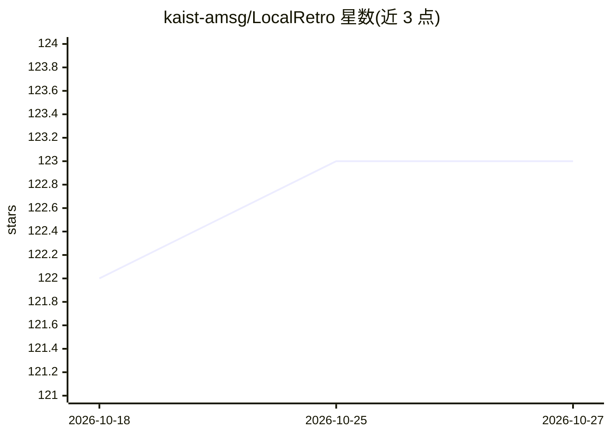

# kaist-amsg/LocalRetro

⭐ 123 · Jupyter Notebook · NOASSERTION · 推送 2026-01-27 · [GitHub](https://github.com/kaist-amsg/LocalRetro) · 组织维护

**给化学研究者的逆合成反应预测模型实现（LocalRetro）**

KAIST/SNU 团队论文 JACS Au 2021 的官方代码实现：基于局部反应性与全局注意力的深度学习模型，预测有机分子的逆合成反应产物。工作流包括下载 USPTO-50K/USPTO-MIT 数据、两步数据预处理（局部反应模板提取与分配）、模型训练（RTX 3090 约 100 分钟）与测试解码。依赖 Python/PyTorch/RDKit/DGL 等库，通过 conda 虚拟环境从源码运行，无打包发布。许可为 CC BY-NC-SA 4.0，学术使用免费，商业使用需书面许可。

## 筛选速览

| 维度 | 判定 | 备注 |
|---|---|---|
| AI 角色 | `ai-native` | 本体是模型或模型工具 |
| 许可风险 | `none` | NOASSERTION |
| 部署形态 | `None` |  |
| 模型依赖 | — | README 未给出锁定关系 |
| 硬件要求 | — | 无带数字的原话,不猜 |
| 安装摩擦 | `medium` | 含编译或系统依赖之一 |
| 成熟度 | — | 结构信号不足 |

## 能力要点

- 局部反应模板驱动的逆合成预测（USPTO_50K 658 个模板 / USPTO_MIT 20,221 个）
- 提供完整训练-测试-解码流程脚本
- 对应 JACS Au 2021 论文的官方实现
- 激活函数已由 ReLU 改为 GeLU，含 stereo-aware/unaware 双指标精度

## 适用场景

- 我想训练并复现论文中的逆合成预测结果
- 在 USPTO 数据集上预测目标分子的可能反应物
- 基于局部反应模板方法开展逆合成研究

## 场景标签

`模型训练` · 领域:训练与推理

## 证据(README 行号)

> L2: Implementation of Retrosynthesis Prediction by LocalRetro developed by Yousung Jung's group at KAIST (now in SNU).
> L50: Shuan Chen and Yousung Jung. Deep Retrosynthetic Reaction Prediction using Local Reactivity and Global Attention, J

## 星数曲线

2026-10-18 122 → 2026-10-27 123（+1）

---
*卡片 v1 · prompt 1.4 · 生成 2026-10-23 · 置信度 high · 依据 README sha `3e30d16c2a5c` · [字段定义](../../DATASET.md)*
