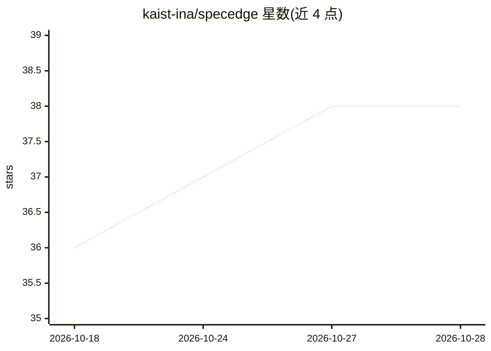

# kaist-ina/specedge

⭐ 38 · Python · NOASSERTION · 推送 2025-11-14 · [GitHub](https://github.com/kaist-ina/specedge) · [官网](https://arxiv.org/abs/2505.17052) · 组织维护

**边云协同的交互式 LLM 推理服务框架（NeurIPS 2025）**

KAIST 研究团队发布的边缘辅助 LLM 推理框架：利用消费级 GPU 在边缘侧做推测解码草稿生成，服务器侧验证，配合主动边缘起草与流水线感知调度来分配边云负载，实验报告 2.22 倍服务器吞吐提升与 11.24% 延迟降低。以源码仓库形式提供，通过 git clone 与 uv sync 安装，依赖 SSH 跨节点通信，服务器与边缘节点需将仓库克隆到相同绝对路径。附带 Auto Batch 与 Server-Only 基线及指标脚本，推测解码基于 SpecExec 的树式方法。

## 筛选速览

| 维度 | 判定 | 备注 |
|---|---|---|
| AI 角色 | `ai-ecosystem` | LLM/agent 周边工具 |
| 许可风险 | `none` | NOASSERTION |
| 部署形态 | `None` |  |
| 模型依赖 | — | README 未给出锁定关系 |
| 硬件要求 | — | 无带数字的原话,不猜 |
| 安装摩擦 | `medium` | 含编译或系统依赖之一 |
| 成熟度 | — | 结构信号不足 |

## 能力要点

- 边云分工：边缘草稿模型 + 服务器目标模型的推测解码
- 主动边缘起草（proactive drafting）与流水线感知调度
- 树式推测解码参数（max_n_beams/max_beam_len/max_branch_width/max_budget）可配置
- 附 Auto Batch 与 Server-Only 基线及指标收集脚本

## 适用场景

- 在边缘设备+云端 GPU 间分担交互式 LLM 服务负载
- 复现边云协同推测解码的吞吐/延迟实验
- 在自有多节点环境上跑 c4/mtbench/oasst 等基准测试

## 场景标签

`推理引擎` · 领域:训练与推理

## 证据(README 行号)

> L7: SpecEdge is an edge-assisted LLM inference framework that leverages consumer-grade GPUs for cost-effective serving a
> L33: git clone https://github.com/kaist-ina/specedge

## 星数曲线

2026-10-18 36 → 2026-10-28 38（+2）

---
*卡片 v1 · prompt 1.4 · 生成 2026-10-25 · 置信度 high · 依据 README sha `aeafbc8b38a4` · [字段定义](../../DATASET.md)*
