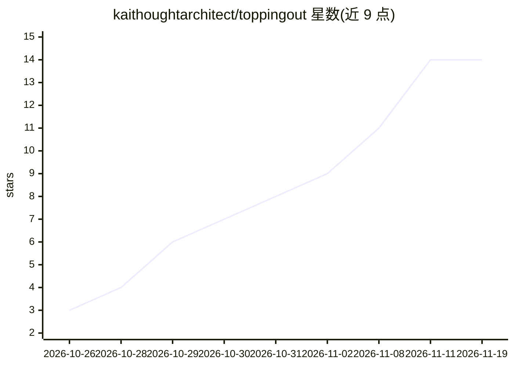

# kaithoughtarchitect/toppingout

⭐ 14 · Python · MIT · 推送 2026-11-18 · [GitHub](https://github.com/kaithoughtarchitect/toppingout) · [官网](https://toppingout.dev) · 个人维护

**为 Claude Code 打造的规范驱动多智能体开发工作流**

运行于 Claude Code 之上的工单驱动开发编排框架：foreman（规划者）在新会话中为每张工单撰写规范与工作令，成本更低的 builder 模型按测试先行实现，来自另一模型家族的 inspector 会话独立审查，合并与推送等敏感操作须所有者批准。每步产出可核验证据（命令输出、commit 哈希、测试名），支持自主运行与夜间批量处理，含 30 个 f- 前缀技能与项目看板、交接文档等文件化机制。脚本依赖 Node、Python 和 Bash。

## 筛选速览

| 维度 | 判定 | 备注 |
|---|---|---|
| AI 角色 | `ai-ecosystem` | LLM/agent 周边工具 |
| 许可风险 | `permissive` | MIT |
| 部署形态 | `None` |  |
| 模型依赖 | — | README 未给出锁定关系 |
| 硬件要求 | — | 无带数字的原话,不猜 |
| 安装摩擦 | `low` | 无编译、无系统依赖或容器化 |
| 成熟度 | — | 结构信号不足 |

## 能力要点

- planner/executor 分离：foreman 只写规范不写代码，builder 不做设计决策
- 跨模型家族审查：由另一模型家族的会话独立检查构建结果
- 所有声明须携带证据（命令输出/commit 哈希/测试名），否则视为未完成
- 30 个技能覆盖规划、调度、审查、归档与夜间运行

## 适用场景

- 夜间让多个模型会话按工单自动推进开发，白天只审证据后合并
- 用低成本模型配合严格规范降低编码 token 消耗
- 为 Claude Code 项目建立带审批边界的自动化开发流程

## 场景标签

`多智能体` `编码 Agent` · 领域:Agent 开发

## 证据(README 行号)

> L5: **A spec-driven software factory for Claude Code that works through your tickets overnight, with a planner/executor 
> L11: > **What Topping Out does:** splits the work. A foreman plans each job in a fresh session and never writes code, a 
> L45: Work orders reach the builder as a one-line pointer: you paste it, or the foreman sends it over a pane link. With a

## 星数曲线

2026-10-26 3 → 2026-11-19 14（+11）

---
*卡片 v1 · prompt 1.4 · 生成 2026-11-18 · 置信度 high · 依据 README sha `5972d16b8cde` · [字段定义](../../DATASET.md)*
