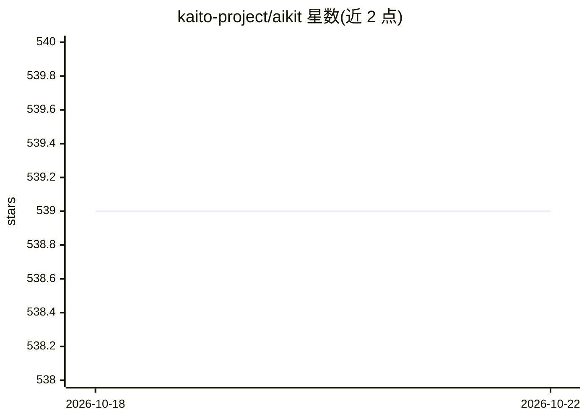

# kaito-project/aikit

⭐ 539 · Go · MIT · 推送 2026-10-19 · [GitHub](https://github.com/kaito-project/aikit) · [官网](https://kaito-project.github.io/aikit/) · 组织维护

**面向开发者的开源 LLM 部署/微调/打包平台**

AIKit 提供基于 LocalAI 的 OpenAI 兼容推理服务、基于 Unsloth 的微调接口，以及将模型打包为 OCI 工件分发到任意 OCI 注册表的 OCI Packaging 能力。以 Docker/Podman 容器镜像方式运行，提供 Qwen、Gemma、Llama、Phi、GPT-OSS 等预构建模型镜像，支持 AMD64/ARM64 CPU 及 NVIDIA CUDA、AMD ROCm（实验性）、Apple Silicon（实验性，仅 gguf）加速，并支持 Kubernetes 部署、多模态、图像生成、TTS 与离线气隙推理。

## 筛选速览

| 维度 | 判定 | 备注 |
|---|---|---|
| AI 角色 | `ai-ecosystem` | LLM/agent 周边工具 |
| 许可风险 | `permissive` | MIT |
| 部署形态 | `self-host` | docker 或自建部署 |
| 模型依赖 | local-ok | 支持本地模型 |
| 硬件要求 | — | 无带数字的原话,不猜 |
| 安装摩擦 | `low` | 无编译、无系统依赖或容器化 |
| 成熟度 | `idea` | |

## 能力要点

- LocalAI 推理后端，OpenAI API 兼容端点与 WebUI
- Unsloth 微调接口与声明式配置
- 模型打包为 OCI 工件（CNCF ModelPack 规范）分发
- CPU/CUDA/ROCm/Apple Silicon 多架构支持，Kubernetes 部署就绪

## 适用场景

- 一条 docker run 命令在本地或服务器托管开源 LLM 并提供 OpenAI 兼容 API
- 用 Unsloth 对开源模型做微调
- 将模型打包为 OCI 工件并分发到容器注册表
- 在 Kubernetes 集群中部署 LLM 推理服务

## 场景标签

`微调` `推理引擎` · 领域:训练与推理

## 证据(README 行号)

> L3: AIKit is a comprehensive platform to quickly get started to host, deploy, build and fine-tune large language models 
> L7: - **Inference**: AIKit uses LocalAI, which supports a wide range of inference capabilities and formats. LocalAI prov
> L11: - **OCI Packaging**: Package models as OCI artifacts for distribution through any OCI-compliant registry. Supports 

## 星数曲线

2026-10-18 539 → 2026-10-22 539（+0）

---
*卡片 v1 · prompt 1.4 · 生成 2026-10-21 · 置信度 high · 依据 README sha `79d2df0d7db3` · [字段定义](../../DATASET.md)*
