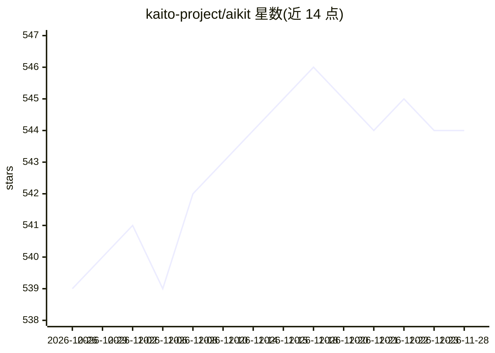

# kaito-project/aikit

⭐ 544 · Go · MIT · 推送 2026-11-23 · [GitHub](https://github.com/kaito-project/aikit) · [官网](https://kaito-project.github.io/aikit/) · 组织维护

**用容器镜像托管、构建、微调和部署开源 LLM 的平台**

AIKit 围绕 Docker/Podman 提供三项能力：推理（内嵌 LocalAI，暴露 OpenAI 兼容 REST API，可接任何兼容客户端）、微调（集成 Unsloth）、OCI 打包（模型以 OCI artifact 经任意 OCI registry 分发，支持 CNCF ModelPack）。README 提供 CPU、NVIDIA CUDA、AMD ROCm 与 Apple Silicon 四类预构建模型镜像的 docker/podman 运行命令，含 Qwen、Llama、Gemma、Phi、GPT-OSS、TTS 与文生图模型，并支持 Kubernetes 部署与气隙推理。

## 筛选速览

| 维度 | 判定 | 备注 |
|---|---|---|
| AI 角色 | `ai-ecosystem` | LLM/agent 周边工具 |
| 许可风险 | `permissive` | MIT |
| 部署形态 | `self-host` | docker 或自建部署 |
| 模型依赖 | local-ok | 支持本地模型 |
| 硬件要求 | — | 无带数字的原话,不猜 |
| 安装摩擦 | `low` | 无编译、无系统依赖或容器化 |
| 成熟度 | — | 结构信号不足 |

## 能力要点

- 推理基于 LocalAI，提供 OpenAI API 兼容端点
- 集成 Unsloth 微调接口
- 模型打包为 OCI artifact 分发，支持 ModelPack 规范
- AMD64/ARM64 CPU 及 NVIDIA CUDA、AMD ROCm、Apple Silicon GPU 加速

## 适用场景

- 本地一条 docker 命令起一个开源模型并获 OpenAI 兼容 API
- 在 Kubernetes 集群中部署 LLM 服务
- 用 Unsloth 对开源模型做微调
- 通过私有 registry 向无网环境分发模型镜像

## 场景标签

`微调` `推理引擎` · 领域:训练与推理

## 证据(README 行号)

> L3: AIKit is a comprehensive platform to quickly get started to host, deploy, build and fine-tune large language models 
> L7: - **Inference**: AIKit uses LocalAI, which supports a wide range of inference capabilities and formats. LocalAI prov
> L9: - **Fine-Tuning**: AIKit offers an extensible fine-tuning interface. It supports Unsloth for fast, memory efficient,
> L11: - **OCI Packaging**: Package models as OCI artifacts for distribution through any OCI-compliant registry. Supports 

## 星数曲线

2026-10-26 539 → 2026-11-28 544（+5）

---
*卡片 v1 · prompt 1.4 · 生成 2026-11-25 · 置信度 high · 依据 README sha `0869f4a74917` · [字段定义](../../DATASET.md)*
