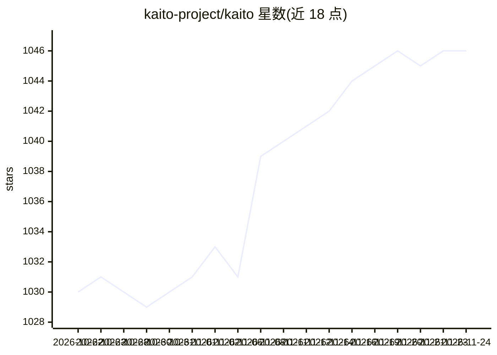

# kaito-project/kaito

⭐ 1,046 · Go · NOASSERTION · 推送 2026-11-22 · [GitHub](https://github.com/kaito-project/kaito) · [官网](https://kaito-project.github.io/kaito/docs/) · 组织维护

**在 Kubernetes 集群中自动化 LLM 推理/微调/RAG 部署的 Operator**

KAITO 是一套 Kubernetes Operator，通过 CRD/controller 模式自动化管理集群内 LLM 推理、微调与 RAG 引擎部署。Workspace CRD 让用户只需提供 GPU 实例类型与 HuggingFace 模型 ID，控制器即估算显存需求、经 Karpenter API 触发 GPU 节点自动供给、按硬件拓扑配置并行度等调度参数；InferenceSet 基于 KEDA 指标自动扩缩副本；RAGEngine 集成向量库、嵌入服务与 LlamaIndex 编排，提供 /index、/v1/chat/completion、/retrieve 等 API。安装使用 helm 或 Terraform，许可证为 Apache 2.0。

## 筛选速览

| 维度 | 判定 | 备注 |
|---|---|---|
| AI 角色 | `ai-ecosystem` | LLM/agent 周边工具 |
| 许可风险 | `none` | NOASSERTION |
| 部署形态 | `None` |  |
| 模型依赖 | local-ok | 支持本地模型 |
| 硬件要求 | — | 无带数字的原话,不猜 |
| 安装摩擦 | `low` | 无编译、无系统依赖或容器化 |
| 成熟度 | — | 结构信号不足 |

## 能力要点

- Workspace CRD 一键部署：输入 GPU 类型与 HuggingFace 模型 ID 即完成模型部署
- NAP 按模型显存估算自动供给 GPU 节点，GPU 本地 NVMe 作模型存储
- 支持所有 vLLM 支持的 HuggingFace 模型、LoRA 适配器与 KVCache offloading
- RAGEngine 提供 RRF 混合检索（BM25+向量），可对接 MCP 服务器

## 适用场景

- 在 K8s 集群中声明式部署与扩缩 LLM 推理服务
- 用 CRD 管理 RAG 服务的嵌入、向量库与检索编排
- 按请求负载自动扩缩推理副本数

## 场景标签

`RAG` `微调` `推理引擎` · 领域:知识与检索

## 证据(README 行号)

> L15: KAITO is an operator suite that automates LLM model inference, fine-tuning, and RAG (Retrieval Augmented Generation
> L25: KAITO follows the classic Kubernetes Custom Resource Definition (CRD)/controller design pattern for workload orches

## 星数曲线

2026-10-22 1,030 → 2026-11-24 1,046（+16）

---
*卡片 v1 · prompt 1.4 · 生成 2026-11-24 · 置信度 high · 依据 README sha `30195b245aa2` · [字段定义](../../DATASET.md)*
