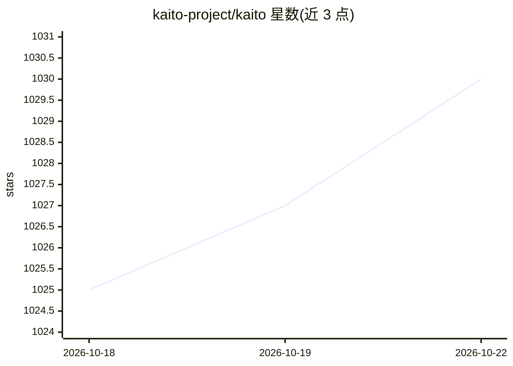

# kaito-project/kaito

⭐ 1,031 · Go · NOASSERTION · 推送 2026-10-22 · [GitHub](https://github.com/kaito-project/kaito) · [官网](https://kaito-project.github.io/kaito/docs/) · 组织维护

**Kubernetes 算子套件：自动化 LLM 推理/微调/RAG 部署**

KAITO 是开源的 Kubernetes CRD/控制器套件，通过 Workspace、InferenceSet、InferencePool 等 CRD 自动化 LLM 推理、微调与 RAG 引擎在集群中的部署：用户给出 GPU 机型与 HuggingFace 模型 ID，控制器估算显存需求、经 Karpenter API 触发 GPU 节点自动供给并配置推理引擎调度参数。当前仅支持 vLLM 引擎（LoRA 适配器支持，KVCache 卸载默认开启）；RAGEngine 基于 LlamaIndex，默认 FAISS 向量库，可选 Qdrant/Milvus。面向在 Kubernetes 上运行 GPU 推理负载的平台/集群运维与开发者。

## 筛选速览

| 维度 | 判定 | 备注 |
|---|---|---|
| AI 角色 | `ai-ecosystem` | LLM/agent 周边工具 |
| 许可风险 | `none` | NOASSERTION |
| 部署形态 | `None` |  |
| 模型依赖 | local-ok | 支持本地模型 |
| 硬件要求 | — | 无带数字的原话,不猜 |
| 安装摩擦 | `low` | 无编译、无系统依赖或容器化 |
| 成熟度 | — | 结构信号不足 |

## 能力要点

- Workspace CRD 一键部署模型：显存估算+GPU 节点自动供给
- 基于 KEDA 与 vLLM 指标的推理副本自动扩缩（InferenceSet）
- 集成 Gateway API Inference Extension，支持 KVCache 感知路由
- RAGEngine 提供 /index、/chat/completion、/retrieve API，RRF 混合检索

## 适用场景

- 在 Kubernetes 集群上部署与扩缩 vLLM 支持的 HuggingFace 模型
- 按推理负载自动伸缩 LLM 服务副本
- 在集群内一键拉起带向量库的 RAG 服务

## 场景标签

`推理引擎` `微调` `RAG` · 领域:知识与检索

## 证据(README 行号)

> L15: KAITO is an operator suite that automates LLM model inference, fine-tuning, and RAG (Retrieval Augmented Generation
> L25: KAITO follows the classic Kubernetes Custom Resource Definition (CRD)/controller design pattern for workload orches
> L34:  Currently, only the **vLLM** engine is supported. LoRA adapters are supported. KVCache offloading is enabled by de

## 星数曲线

2026-10-18 1,025 → 2026-10-22 1,030（+5）

---
*卡片 v1 · prompt 1.4 · 生成 2026-10-21 · 置信度 high · 依据 README sha `53438087ddee` · [字段定义](../../DATASET.md)*
