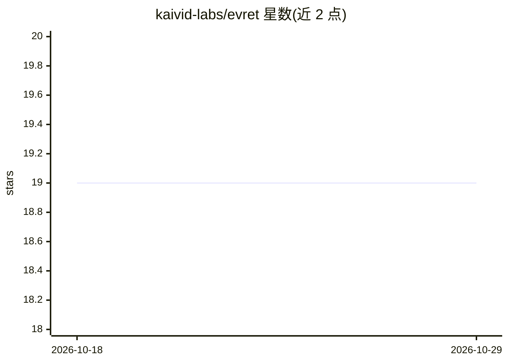

# kaivid-labs/evret

⭐ 19 · Python · MIT · 推送 2026-07-19 · [GitHub](https://github.com/kaivid-labs/evret) · [官网](https://kaivid-labs.github.io/evret/) · 个人维护

**检索系统评测框架：为推荐/RAG/搜索计算标准 IR 指标**

Python 检索评测框架，面向推荐、RAG 与搜索系统的检索器评估：提供 Hit Rate、Recall、Precision、MRR、NDCG、ERR、RBP、Average Precision 八类标准 IR 指标。相关性判定通过 Judge 机制实现，含 TokenOverlapJudge（默认）、基于嵌入相似度的 SemanticJudge 与可指定 provider/model 的 LLMJudge。数据集支持 Python 构造及 JSON/CSV 加载；提供 Qdrant 检索器适配器与 LangChain 集成适配器。要求 Python 3.10+，MIT 许可，pip 安装。

## 筛选速览

| 维度 | 判定 | 备注 |
|---|---|---|
| AI 角色 | `ai-ecosystem` | LLM/agent 周边工具 |
| 许可风险 | `permissive` | MIT |
| 部署形态 | `library` | 以包/库形式分发 |
| 模型依赖 | — | README 未给出锁定关系 |
| 硬件要求 | — | 无带数字的原话,不猜 |
| 安装摩擦 | `low` | 无编译、无系统依赖或容器化 |
| 成熟度 | — | 结构信号不足 |

## 能力要点

- 8 类标准 IR 指标（Hit Rate/Recall/Precision/MRR/NDCG/ERR/RBP/AP）
- 三种 Judge 判定：token 重叠、语义相似度、LLM 评审
- 数据集支持 JSON/CSV 加载与程序化构造
- Qdrant 原生适配器与 LangChain 集成适配器

## 适用场景

- 评估 RAG 系统检索器的排序质量
- 对比不同检索配置下的 Recall/MRR 等指标
- 为搜索系统建立回归评测数据集与自动化测试

## 场景标签

`模型评测` `RAG` · 领域:评测与运维

## 证据(README 行号)

> L3: **A focused, lightweight retriever evaluation framework with standard Information Retrieval metrics**
> L16: **Evret** is a modern Python framework designed for evaluating retrieval systems in Information Retrieval pipelines

## 星数曲线

2026-10-18 19 → 2026-10-29 19（+0）

---
*卡片 v1 · prompt 1.4 · 生成 2026-10-28 · 置信度 high · 依据 README sha `72af47b4929d` · [字段定义](../../DATASET.md)*
