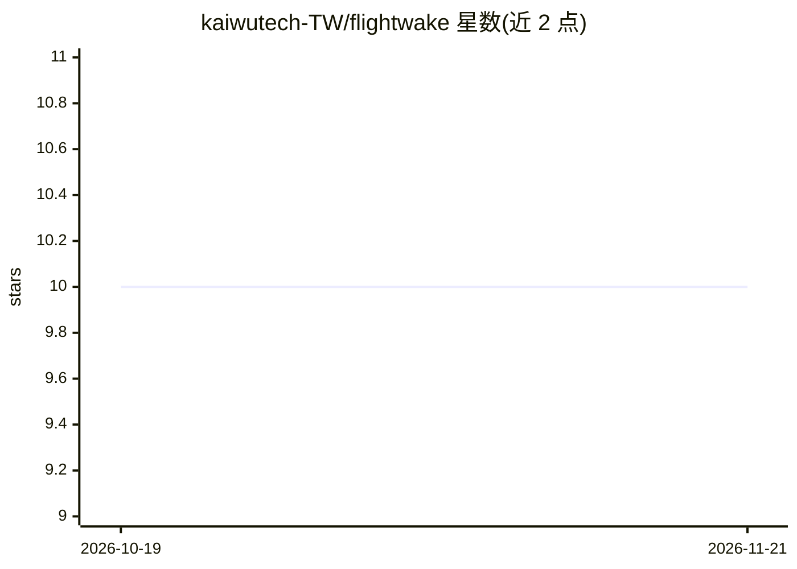

# kaiwutech-TW/flightwake

⭐ 10 · TypeScript · MIT · 推送 2026-11-15 · [GitHub](https://github.com/kaiwutech-TW/flightwake) · [官网](https://flightwake.kaiwu.com.tw/) · 组织维护 · 中文 README

**给 AI 编码 agent 的跨会话工作记录与交接框架**

以 npm 包形式安装到目标仓库的 agent 工作流框架：在 .flightwake/ 目录维护四个纯 Markdown 文件（STATE、决策日志、陷阱清单、飞行记录），由 agent 在工作中写入，Claude Code、Codex、Antigravity、Gemini CLI 在每次会话开始时读取，实现新会话安全接管。带 /fw-coldstart 冷启动、Stop hook 提醒、CI 检查、多 agent 角色分工等机制；零运行时依赖，仅安装器与 hook 需要 Node ≥18。

## 筛选速览

| 维度 | 判定 | 备注 |
|---|---|---|
| AI 角色 | `ai-ecosystem` | LLM/agent 周边工具 |
| 许可风险 | `permissive` | MIT |
| 部署形态 | `library` | 以包/库形式分发 |
| 模型依赖 | — | README 未给出锁定关系 |
| 硬件要求 | — | 无带数字的原话,不猜 |
| 安装摩擦 | `low` | 无编译、无系统依赖或容器化 |
| 成熟度 | — | 结构信号不足 |

## 能力要点

- 四文件状态体系（STATE/DECISIONS/TRAPS/records）随 git 随仓库传递
- 陷阱锚定机制：编辑相关文件或运行命令后立即提示（hook 不阻塞）
- /fw-coldstart 冷启动可在约 25 秒报告上一次会话进度
- 支持 Claude Code、Codex、Antigravity、Gemini CLI 共享同一套状态文件

## 适用场景

- 跨多个会话/多名开发者接续的编码项目交接
- 同一仓库混用多个 AI 编码工具时共享工作状态
- 记录架构决策原因与已踩过的陷阱供后续会话查阅
- agent 团队分工（项目经理/技术负责人/编码/评审）协作

## 场景标签

`Agent 记忆` · 领域:Agent 开发

## 证据(README 行号)

> L23: flight record per stretch of work. The agent writes them as it works; Claude Code, Codex and Antigravity read them 
> L44: Zero runtime dependencies (Node ≥18 for the installer and the hooks). Verified on Claude Code, Codex and Antigravit

## 星数曲线

2026-10-19 10 → 2026-11-21 10（+0）

---
*卡片 v1 · prompt 1.4 · 生成 2026-11-20 · 置信度 high · 依据 README sha `8d26d14ffd51` · [字段定义](../../DATASET.md)*
