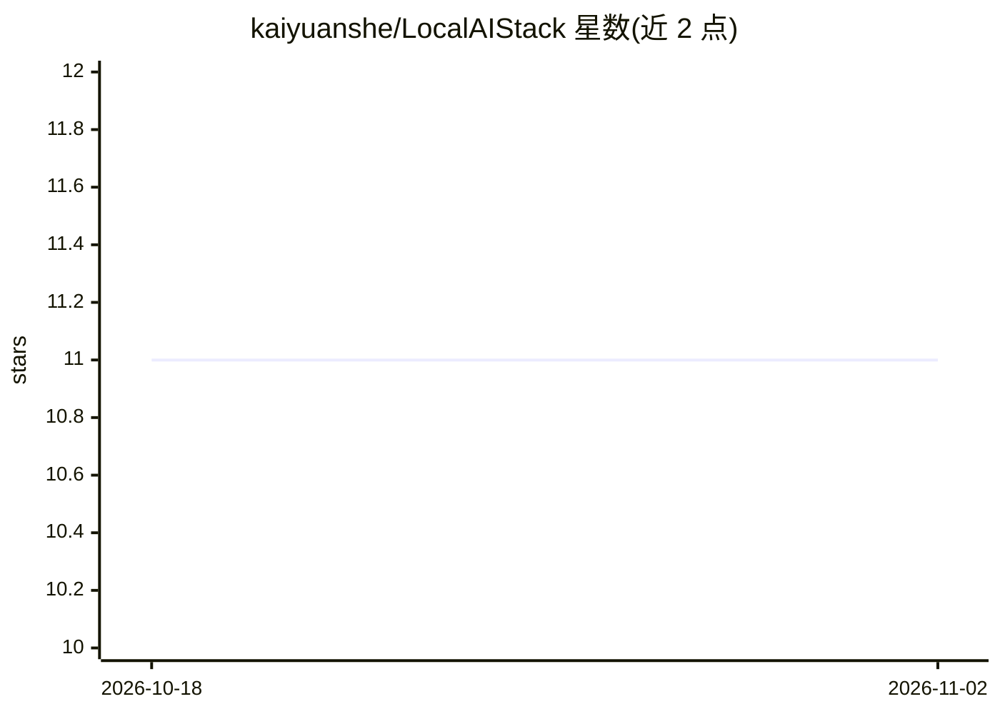

# kaiyuanshe/LocalAIStack

⭐ 11 · Go · Apache-2.0 · 推送 2026-06-24 · [GitHub](https://github.com/kaiyuanshe/LocalAIStack) · 组织维护 · 中文 README

**面向开发者的本地 AI 工作站软件栈：统一安装管理推理运行时与模型**

开源（Apache 2.0）的模块化软件栈，将本地 AI 工作站作为基础设施管理：提供 CLI 与 Web 管理界面，在本地硬件上安装、升级、卸载推理运行时（Ollama、llama.cpp、vLLM、SGLang 等）、AI 框架、数据服务与 AI 应用；支持从 Hugging Face、ModelScope、Ollama 搜索下载 GGUF/safetensors 模型并按格式自动选择运行时启动。按硬件能力分级（Tier 1-3）自动适配可用功能，smart-run 基于硬件与模型上下文建议运行参数。使用方式为 git clone 后 make 编译生成 CLI 与服务端，支持 Ubuntu/Windows 11/WSL2；项目自述正在积极开发中，初期聚焦 Tier 2（约 30B）本地推理流程。

## 筛选速览

| 维度 | 判定 | 备注 |
|---|---|---|
| AI 角色 | `ai-ecosystem` | LLM/agent 周边工具 |
| 许可风险 | `permissive` | Apache-2.0 |
| 部署形态 | `desktop` | 安装包/桌面程序 |
| 模型依赖 | local-ok | 支持本地模型 |
| 硬件要求 | — | 无带数字的原话,不猜 |
| 安装摩擦 | `medium` | 含编译或系统依赖之一 |
| 成熟度 | `idea` | |

## 能力要点

- 硬件感知分级（Tier 1-3）并自动适配可安装软件
- 统一模型管理：HF/ModelScope/Ollama 来源，GGUF→llama.cpp、safetensors→vLLM 自动分流
- 模块化管理推理运行时、框架、数据服务与 AI 应用，支持安装/升级/清理/配置规划
- smart-run 基于硬件与模型上下文生成运行参数建议并持久化缓存

## 适用场景

- 在本机统一安装管理 Ollama、llama.cpp、vLLM 等推理运行时
- 搜索下载 GGUF/safetensors 模型并本地启动推理
- 搭建企业私有或教学用途的本地 AI 开发环境
- 对模型运行失败进行记录、诊断与参数建议

## 场景标签

`推理引擎` · 领域:训练与推理

## 证据(README 行号)

> L7: 它提供统一的控制层，用于在本地硬件上安装、管理、升级并运行 AI 开发环境、推理运行时、模型和应用，无需依赖云服务或厂商专有平台。
> L61: ### 3. 本地 AI 推理运行时
> L127: LocalAIStack 提供统一的模型管理层：

## 星数曲线

2026-10-18 11 → 2026-11-02 11（+0）

---
*卡片 v1 · prompt 1.4 · 生成 2026-11-02 · 置信度 mid · 依据 README sha `a194ce845aa6` · [字段定义](../../DATASET.md)*
