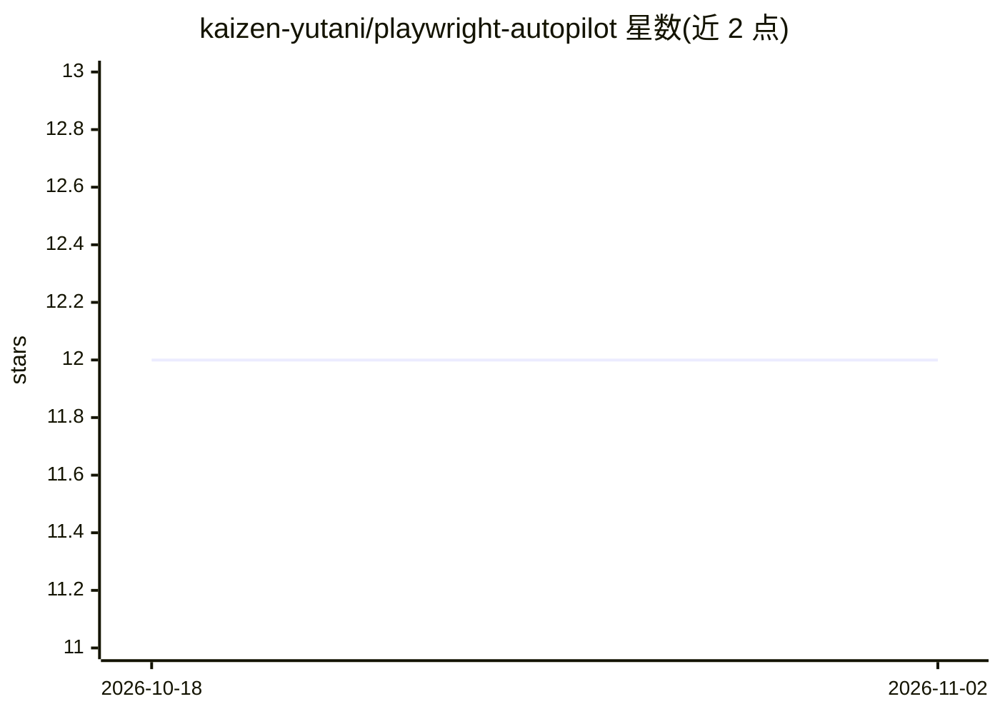

# kaizen-yutani/playwright-autopilot

⭐ 12 · JavaScript · 推送 2026-04-12 · [GitHub](https://github.com/kaizen-yutani/playwright-autopilot) · [官网](https://dev.to/) · 个人维护

**自主调试修复 Playwright E2E 测试的 Claude Code 插件**

面向使用 Claude Code 的测试开发者：插件通过注入 captureHook 到 Playwright worker 进程，捕获每次浏览器操作的前后 DOM 快照、网络请求、控制台输出与截图；经 MCP 暴露 37 个工具供 Claude 调用，按需拉取失败证据定位根因并生成最小 diff 修复。另含业务流记忆（.e2e-flows.json 跨会话持久化）、flaky 检测、证据打包与 HTML 报告、整套 triage 分类、覆盖缺口分析。要求 Claude Code CLI、Node.js 20+ 与 Playwright 测试项目。

## 筛选速览

| 维度 | 判定 | 备注 |
|---|---|---|
| AI 角色 | `ai-ecosystem` | LLM/agent 周边工具 |
| 许可风险 | `none` | — |
| 部署形态 | `None` |  |
| 模型依赖 | — | README 未给出锁定关系 |
| 硬件要求 | — | 无带数字的原话,不猜 |
| 安装摩擦 | `low` | 无编译、无系统依赖或容器化 |
| 成熟度 | — | 结构信号不足 |

## 能力要点

- 注入式 captureHook 捕获 DOM 快照/网络/控制台/截图，无需修改 Playwright 源码
- 37 个 MCP 工具按需拉取证据，含交互式浏览器探索
- 业务流记忆持久化于 .e2e-flows.json，跨会话累积
- flaky 检测（retries/repeatEach 双模式）与失败分类 triage

## 适用场景

- 让 Claude 自主定位并修复失败的 Playwright 测试
- 对整个测试套件做失败分类与健康度跟踪
- 扫描项目找出测试覆盖缺口
- 把失败证据打包为 Jira 工单附件

## 场景标签

`编码 Agent` · 领域:编码与开发

## 证据(README 行号)

> L6: A Claude Code plugin that debugs and fixes Playwright E2E tests autonomously. It runs your tests with full action ca
> L52: The plugin exposes 37 tools via the Model Context Protocol that Claude calls on-demand. This is token-efficient by 

## 星数曲线

2026-10-18 12 → 2026-11-02 12（+0）

---
*卡片 v1 · prompt 1.4 · 生成 2026-11-01 · 置信度 high · 依据 README sha `7373b5918da2` · [字段定义](../../DATASET.md)*
