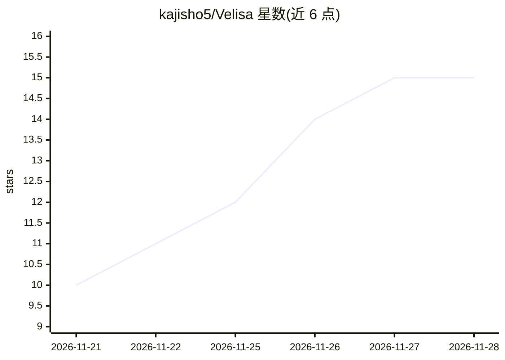

# kajisho5/Velisa

⭐ 15 · Python · MIT · 推送 2026-11-27 · [GitHub](https://github.com/kajisho5/Velisa) · 个人维护

**为独立视频生产 Skill/Agent 提供开放契约与共享执行基础设施**

定位为 AI 原生视频生产的契约层与共享执行基础设施，而非 AI 视频生成器：定义意图→Agent 规划→确定性 Skill 执行→QC 验证的分工，提供 Capability Contract JSON Schema、能力注册表（含冲突检测与三级策略）、SkillPact 一致性检查与 ProductionReceipt 审计回执。仓库本体主要是架构文档与注册表/安装器，随附一个 Claude Code 插件市场，并可通过一键脚本安装包含 1 个编排 Agent 与 10 个 Skill 仓库的完整生态。多数设计项标注为 Planned 或 Vision，作者明确声明不成熟。

## 筛选速览

| 维度 | 判定 | 备注 |
|---|---|---|
| AI 角色 | `ai-ecosystem` | LLM/agent 周边工具 |
| 许可风险 | `permissive` | MIT |
| 部署形态 | `library` | 以包/库形式分发 |
| 模型依赖 | — | README 未给出锁定关系 |
| 硬件要求 | — | 无带数字的原话,不猜 |
| 安装摩擦 | `medium` | 含编译或系统依赖之一 |
| 成熟度 | `idea` | |

## 能力要点

- Capability Contract JSON Schema 与参考注册表（冲突检测+三级策略）
- Agent 决定做什么、Runtime 决定怎么做的确定性分工（禁止 raw shell/filter 字符串）
- 一键安装器克隆 11 个仓库并链接 Skill 到 Claude Code/Codex
- 八项 conformance 检查与 ProductionReceipt 执行回执

## 适用场景

- 让多个独立视频生产 Skill 共享同一契约与注册表接入
- 为视频流水线补齐验证与出处（provenance）记录
- 通过 Claude Code 插件市场安装生态内 Skill

## 场景标签

`Agent 框架` · 领域:Agent 开发

## 证据(README 行号)

> L24: A set of open contracts and shared execution infrastructure that let independent
> L118: |Reference Capability registry|**Implemented** — `registry/registry.py`: who provides Capability X, collision dete
> L191: links every Skill that has a `SKILL.md` into `~/.claude/skills/` (Claude Code) and

## 星数曲线

2026-11-21 10 → 2026-11-28 15（+5）

---
*卡片 v1 · prompt 1.4 · 生成 2026-11-21 · 置信度 mid · 依据 README sha `9eb703c14c0d` · [字段定义](../../DATASET.md)*
