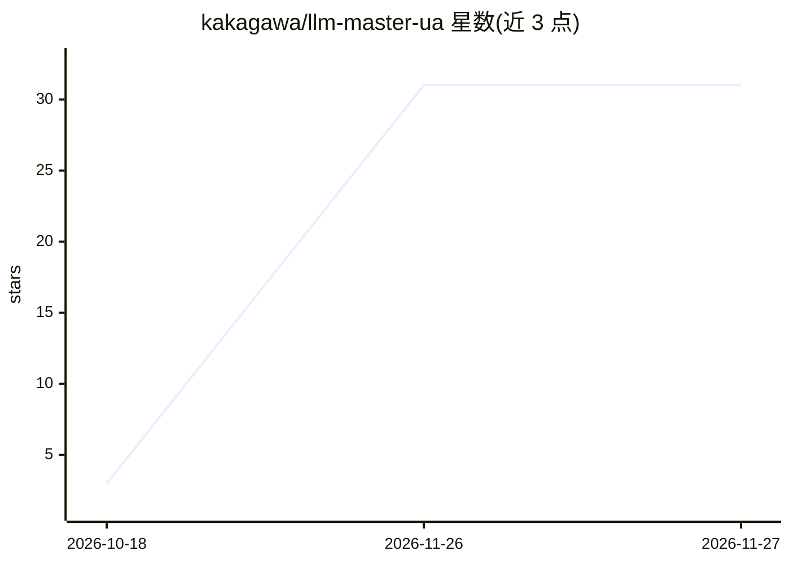

# kakagawa/llm-master-ua

⭐ 31 · Python · NOASSERTION · 推送 2026-09-16 · [GitHub](https://github.com/kakagawa/llm-master-ua) · [官网](https://kakagawa.github.io/llm-master-ua/) · 个人维护 · 中文 README

**LLM 工程课程乌克兰语本地化版：126 篇文章覆盖 RAG/Agent/部署**

youngyangyang04/llm-master 的乌克兰语改编版，是有序的 LLM 工程学习路径：基础概念→API 调用→RAG→Agents→微调与部署→Transformer→项目与面试。126 篇文章配有可运行代码（Python 3.14 + numpy 已验证），466 张插图本地存储，提供了约 120 个术语的统一词汇表，还包含三个原创文章：乌克兰语 tokenization 测量、乌克兰地区 API 访问、欧盟 AI 法案。包含两个 Node 脚本，用于 tokenization 测量和链接验证。面向有经验的开发者。

## 筛选速览

| 维度 | 判定 | 备注 |
|---|---|---|
| AI 角色 | `ai-knowledge` | 知识聚合/清单类 |
| 许可风险 | `none` | NOASSERTION |
| 部署形态 | `library` | 以包/库形式分发 |
| 模型依赖 | — | README 未给出锁定关系 |
| 硬件要求 | — | 无带数字的原话,不猜 |
| 安装摩擦 | `low` | 无编译、无系统依赖或容器化 |
| 成熟度 | — | 结构信号不足 |

## 能力要点

- 126 篇文章 + 可运行代码的 LLM 工程课程
- 乌克兰语 tokenization 测量（自建平行语料）
- 包含部署主题：vLLM, SGLang, KV Cache, 量化
- 466 张插图本地存储

## 适用场景

- 使用乌克兰语从零开始学习 LLM 工程
- 准备 LLM 相关职位面试
- 需要乌克兰语版本以在团队内培训

## 场景标签

`教程课程` · 领域:学习与行业

## 证据(README 行号)

> L19: `LLM Master UA` — це послідовний шлях: **базові поняття → виклик моделі → RAG → агенти →
> L24: ## Що всередині
> L30: |RAG|чанкінг, embedding, векторні БД, гібридний пошук, rerank, оцінювання|Тема: RAG|

## 星数曲线

2026-10-18 3 → 2026-11-27 31（+28）

---
*卡片 v1 · prompt 1.4 · 生成 2026-11-26 · 置信度 high · 依据 README sha `3b7307acbdc9` · [字段定义](../../DATASET.md)*
