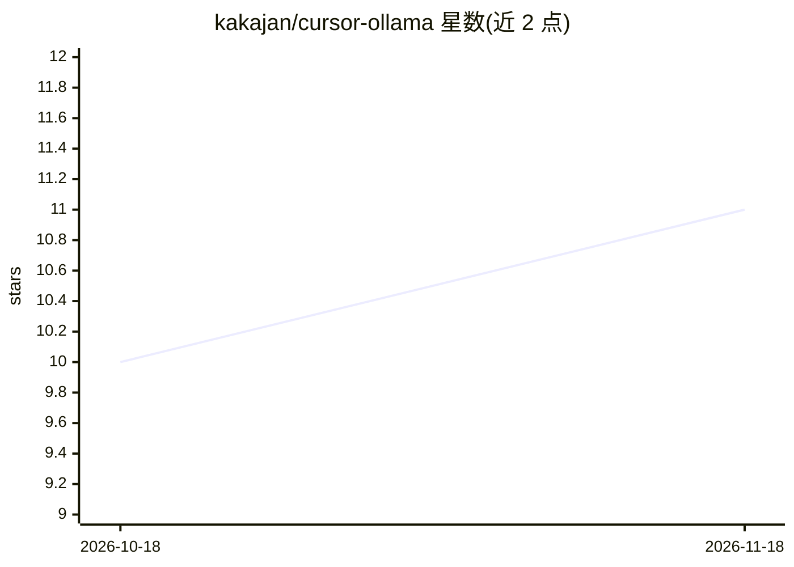

# kakajan/cursor-ollama

⭐ 11 · JavaScript · MIT · 推送 2026-07-07 · [GitHub](https://github.com/kakajan/cursor-ollama) · [官网](https://kakajan.github.io/cursor-ollama/) · 个人维护

**将本地 Ollama 模型经隧道接入 Cursor IDE 的 CLI 工具**

开源 CLI：为 Cursor 提供一个可达的公网 HTTPS /v1 端点（经 Cloudflare Tunnel），内置 OpenAI 兼容代理并以 Bearer auth 保护请求，转发至本地 Ollama 服务器；支持模型别名映射（如 gpt-4-turbo 映射到真实 Ollama 模型）、命名隧道或临时 trycloudflare 快速隧道、Windows 安装向导、系统托盘、健康检查与卸载清理。需 Node.js 18+、Ollama 与 cloudflared；Cursor 是外部 IDE，需用户在 Cursor 设置中填入 Base URL 与 API key。

## 筛选速览

| 维度 | 判定 | 备注 |
|---|---|---|
| AI 角色 | `ai-ecosystem` | LLM/agent 周边工具 |
| 许可风险 | `permissive` | MIT |
| 部署形态 | `desktop` | 安装包/桌面程序 |
| 模型依赖 | local-ok | 支持本地模型 |
| 硬件要求 | — | 无带数字的原话,不猜 |
| 安装摩擦 | `low` | 无编译、无系统依赖或容器化 |
| 成熟度 | — | 结构信号不足 |

## 能力要点

- 通过 Cloudflare Tunnel + OpenAI 兼容代理将本地 Ollama 暴露给 Cursor
- Bearer auth 保护和 Cursor 可接受的模型别名重写
- 向导式配置与系统托盘、doctor/verify 健康检查命令
- 支持命名隧道与临时 trycloudflare 快速隧道两种模式

## 适用场景

- 在 Cursor 中使用本地 Ollama 模型而无需重复配置隧道
- 无 Cloudflare 域名时用快速隧道临时体验本地模型
- 团队内将本地模型以统一别名暴露给多个开发环境

## 场景标签

 · 领域:开发者工具/本地 LLM 接入

## 证据(README 行号)

> L5: cursor-ollama is a free, open-source CLI that connects local Ollama models to Cursor IDE through a secure Cloudflare
> L22: Cursor can use OpenAI-compatible endpoints, but some Cursor flows cannot simply reach `localhost` on your machine. 

## 星数曲线

2026-10-18 10 → 2026-11-18 11（+1）

---
*卡片 v1 · prompt 1.4 · 生成 2026-11-18 · 置信度 high · 依据 README sha `4b6ad9c2fa34` · [字段定义](../../DATASET.md)*
