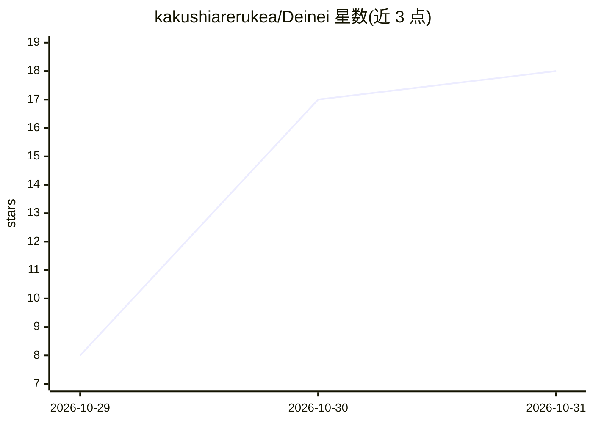

# kakushiarerukea/Deinei

⭐ 18 · TypeScript · MIT · 推送 2026-10-30 · [GitHub](https://github.com/kakushiarerukea/Deinei) · [官网](https://x.com/DeineiDev) · 个人维护

**全本地 AI 陪伴应用：长期记忆 RAG + 3D/Live2D 形象 + 实时语音**

面向消费者的本地运行 AI 陪伴软件：LLM 推理（llama.cpp）、长期记忆向量库（ChromaDB）、Live2D/VRM 3D 形象渲染与 Irodori-TTS 语音合成全部在用户 PC 本地完成，外部通信仅限首次安装、开启 Web 搜索等明确操作。核心机制包括 16 块遗忘滑动压缩、基于 ruri-v3-310m 的 Fact/Episode 双层亲代检索、有向树世界线分离防止分支记忆污染，以及相对时间标签注入。上下文长度设计为 16,384 token，要求 NVIDIA GPU（VRAM 8GB 起、Turing 架构后）。Windows 通过 ZIP + install.bat 自动安装，附带约 15.3GB 模型下载。

## 筛选速览

| 维度 | 判定 | 备注 |
|---|---|---|
| AI 角色 | `ai-native` | 本体是模型或模型工具 |
| 许可风险 | `permissive` | MIT |
| 部署形态 | `None` |  |
| 模型依赖 | — | README 未给出锁定关系 |
| 硬件要求 | `gpu-8g` | |
| 安装摩擦 | `medium` | 含编译或系统依赖之一 |
| 成熟度 | `idea` | |

## 能力要点

- 16 块遗忘滑动 + ChromaDB 亲代检索的长期记忆机制
- 有向树世界线分离：分支回滚/编辑时防止记忆污染
- Live2D 与 VRM 3D 双形象，FFT 口型同步与情感时间线
- Irodori-TTS 24kHz 本地零样本语音合成，先行缓存降低等待

## 适用场景

- 在自家 GPU 上运行不依赖云端服务的 AI 陪伴对话
- 带长期记忆与形象/语音的持续角色互动
- 外出时通过 Tailscale 远程访问本地实例

## 场景标签

`聊天机器人` `语音 Agent` `Agent 记忆` · 领域:Agent 开发

## 证据(README 行号)

> L7:  ローカルLLM推論 × 長期記憶RAG × Live2D / VRM 3D × リアルタイム音声合成
> L29: > 本ソフトウェアは、LLM推論・長期記憶ベクトルDB（ChromaDB）・Live2D/VRM描画・TTS音声合成のすべてがPCローカル内で完結する設計です。

## 星数曲线

2026-10-29 8 → 2026-10-31 18（+10）

---
*卡片 v1 · prompt 1.4 · 生成 2026-10-30 · 置信度 high · 依据 README sha `6b58c0a3da79` · [字段定义](../../DATASET.md)*
