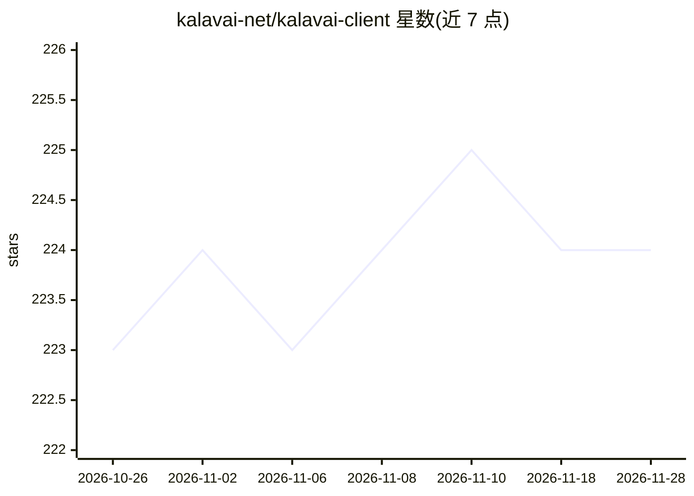

# kalavai-net/kalavai-client

⭐ 224 · TypeScript · Apache-2.0 · 推送 2026-11-27 · [GitHub](https://github.com/kalavai-net/kalavai-client) · [官网](https://kalavai-net.github.io/kalavai-client/) · 组织维护

**整合闲置 GPU 资源跑大型 AI 工作负载的开源平台客户端**

kalavai-client 是 Kalavai 平台的主交互工具：将多台机器（本地、自建机房、多云）的闲置 GPU/CPU 聚合为统一的资源池（pool），由 seed 节点作控制面、worker 节点承载负载。内置模板部署常见 AI 组件——vLLM/llama.cpp/SGLang 推理、Ray 集群、n8n/Flowise 工作流、Langfuse 监控、LiteLLM/OpenWebUI 等，并支持多节点多 GPU 部署与分数 GPU 共享。README 自述项目处于早期阶段，稳定版（v1.0）之前可能出现破坏性变更。客户端为 Python 包，提供 GUI，seed 与 worker 均需 Docker 及 root 权限。

## 筛选速览

| 维度 | 判定 | 备注 |
|---|---|---|
| AI 角色 | `ai-ecosystem` | LLM/agent 周边工具 |
| 许可风险 | `permissive` | Apache-2.0 |
| 部署形态 | `library` | 以包/库形式分发 |
| 模型依赖 | local-ok | 支持本地模型 |
| 硬件要求 | — | 无带数字的原话,不猜 |
| 安装摩擦 | `medium` | 含编译或系统依赖之一 |
| 成熟度 | `idea` | |

## 能力要点

- 聚合多源计算资源为统一控制面的 GPU 资源池
- 内置模板部署 vLLM、llama.cpp、Ray 等推理与工作流组件
- 支持多节点多 GPU 部署与分数 GPU 利用
- 提供 GUI（默认 http://localhost:49153）

## 适用场景

- 把实验室或办公室闲置的电脑 GPU 拼成推理集群
- 统一管理本地与多云机器上的 AI 模型部署
- 低成本跑 CPU/GPU 模型推理与微调任务

## 场景标签

`推理引擎` `微调` · 领域:训练与推理

## 证据(README 行号)

> L8: # Kalavai aggregates and coordinates spare GPU capacity
> L10: Kalavai is an **open source** platform that unlocks **computing from spare capacity**. It aggregates resources from
> L19: - **Ready-made templates to deploy common AI building blocks**: model inference (vLLM, llama.cpp, SGLang), GPU clus

## 星数曲线

2026-10-26 223 → 2026-11-28 224（+1）

---
*卡片 v1 · prompt 1.4 · 生成 2026-11-27 · 置信度 high · 依据 README sha `cf02a128d64e` · [字段定义](../../DATASET.md)*
