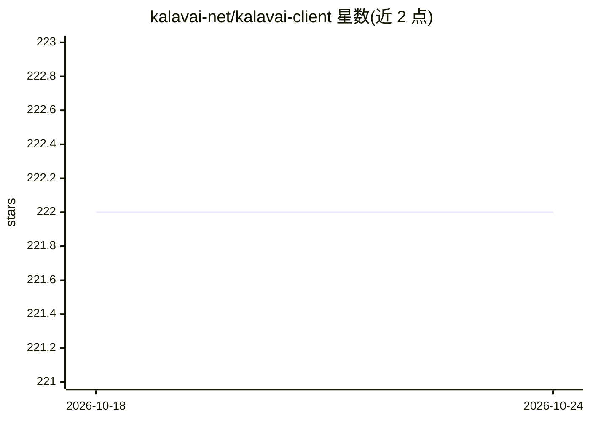

# kalavai-net/kalavai-client

⭐ 223 · TypeScript · Apache-2.0 · 推送 2026-10-17 · [GitHub](https://github.com/kalavai-net/kalavai-client) · [官网](https://kalavai-net.github.io/kalavai-client/) · 组织维护

**聚合闲置 GPU 算力并统一调度部署 AI 工作负载的开源平台**

开源算力聚合平台：将本地、本地机房与多云的闲置资源组成资源池，由 seed 节点作控制平面、worker 节点执行工作负载，支持 ARM64/AMD64 CPU 与 NVIDIA/AMD GPU、多节点多卡部署及 fractional GPU。提供模板部署 vLLM、llama.cpp、Ray 等推理引擎及 n8n、Langfuse、OpenWebUI 等工具，也可扩展自定义负载。客户端以 pip 包分发，seed/worker 需 Docker 与 root 权限，源码构建需 Python≥3.12。项目自述处于早期阶段，v1.0 前可能有破坏性变更。

## 筛选速览

| 维度 | 判定 | 备注 |
|---|---|---|
| AI 角色 | `ai-ecosystem` | LLM/agent 周边工具 |
| 许可风险 | `permissive` | Apache-2.0 |
| 部署形态 | `library` | 以包/库形式分发 |
| 模型依赖 | local-ok | 支持本地模型 |
| 硬件要求 | — | 无带数字的原话,不猜 |
| 安装摩擦 | `medium` | 含编译或系统依赖之一 |
| 成熟度 | `idea` | |

## 能力要点

- 本地/本地机房/多云资源的统一控制平面
- 支持 ARM64/AMD64 CPU 与 NVIDIA/AMD GPU 的多节点多卡部署
- 现成模板部署 vLLM、llama.cpp、Ray 等 AI 引擎与配套工具
- 提供 GUI（默认 localhost:49153）与 pip 安装的 Python 客户端

## 适用场景

- 把团队闲置的笔记本/台式机 GPU 聚合成可运行大模型的算力池
- 在自有硬件上自助部署 vLLM/llama.cpp 推理与 OpenWebUI 等服务
- 在不增加采购的前提下运行多节点微调与推理工作负载

## 场景标签

`推理引擎` `微调` `MLOps` · 领域:训练与推理

## 证据(README 行号)

> L10: Kalavai is an **open source** platform that unlocks **computing from spare capacity**. It aggregates resources from
> L19: - **Ready-made templates to deploy common AI building blocks**: model inference (vLLM, llama.cpp, SGLang), GPU clus

## 星数曲线

2026-10-18 222 → 2026-10-24 222（+0）

---
*卡片 v1 · prompt 1.4 · 生成 2026-10-22 · 置信度 high · 依据 README sha `6344fd601bc7` · [字段定义](../../DATASET.md)*
