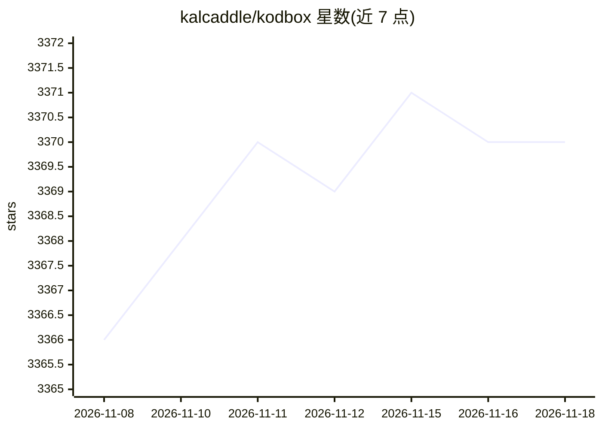

# kalcaddle/kodbox

⭐ 3,370 · PHP · 推送 2026-11-13 · [GitHub](https://github.com/kalcaddle/kodbox) · [官网](https://kodcloud.com) · 组织维护 · 中文 README

**自托管的 Web 文件管理与协作系统（私有云盘）**

基于 PHP 的自托管 Web 文件管理系统，前身为 kodexplorer，功能覆盖在线预览/编辑数百种文件格式、文本与 Markdown 编辑器（120 种代码语言高亮）、在线解压、多存储融合挂载（本地/FTP/WebDAV/OSS/COS/minio/S3 等）、外链共享、细粒度权限与行为审计、文件去重秒传和历史版本。面向需要私有部署网盘的企业与团队，提供插件中心与 SDK，可在 Linux/Windows/Mac 上运行，仅需 PHP 5.3+ 与数据库，也可跑在路由器或 NAS 上。

## 筛选速览

| 维度 | 判定 | 备注 |
|---|---|---|
| AI 角色 | `ai-enhanced` | 去掉 AI 部分产品仍成立 |
| 许可风险 | `none` | — |
| 部署形态 | `None` |  |
| 模型依赖 | — | README 未给出锁定关系 |
| 硬件要求 | — | 无带数字的原话,不猜 |
| 安装摩擦 | `low` | 无编译、无系统依赖或容器化 |
| 成熟度 | — | 结构信号不足 |

## 能力要点

- 多存储融合挂载：本地、FTP、WebDAV、阿里云 OSS、腾讯云 COS、minio、S3 等
- 在线预览/编辑数百种文件格式，含 Office、PDF、CAD、PS/AI 文件
- 细粒度权限控制、行为审计与登录安全机制
- COW 机制文件去重与秒传，历史版本自动生成

## 适用场景

- 团队搭建私有云盘并按部门做权限管理
- 在线预览和编辑文档，无需本地安装软件
- 跨多个云存储统一管理与备份文件
- 通过外链向外部伙伴共享文件并控制有效期与权限

## 场景标签

 · 领域:文件管理/协同办公

## 证据(README 行号)

> L12: > kodbox is a file manager for web. It is also a web code editor, which allows you to develop websites directly wit
> L22: * 🚀 Private cloud disk/enterprise network disk like Windows experience

## 星数曲线

2026-11-08 3,366 → 2026-11-18 3,370（+4）

---
*卡片 v1 · prompt 1.4 · 生成 2026-11-17 · 置信度 low · 依据 README sha `4dbb55ae83af` · [字段定义](../../DATASET.md)*
