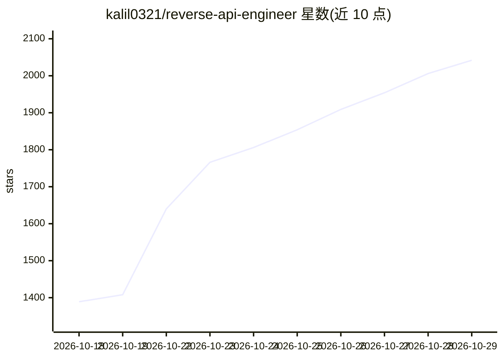

# kalil0321/reverse-api-engineer

⭐ 2,042 · Python · MIT · 推送 2026-10-27 · [GitHub](https://github.com/kalil0321/reverse-api-engineer) · [官网](https://reverseapi.dev) · 个人维护

**把网站逆向成类型化 API 客户端的 AI agent 工具**

面向开发者的 CLI 工具：给定网站与目标，通过浏览器（人工驱动或 AI agent 自动驱动）捕获网络流量为 HAR 文件，再由配置的模型读取流量并生成 Python/JavaScript/TypeScript/Go 等 10 种语言的 API 客户端。提供 manual/agent/engineer/collector 四种模式，agent 模式支持 Playwright MCP、Chrome MCP 与 Vercel agent-browser CLI 三种提供方。模型侧默认 Claude SDK（Sonnet 4.6），可选 OpenCode/Cursor/Copilot SDK，并可通过 OpenCode 接入本地 Ollama。限制：不支持的旧平台（Intel macOS/32 位 Windows）无安装路径，部分输出语言需额外工具链。

## 筛选速览

| 维度 | 判定 | 备注 |
|---|---|---|
| AI 角色 | `ai-native` | 本体是模型或模型工具 |
| 许可风险 | `permissive` | MIT |
| 部署形态 | `library` | 以包/库形式分发 |
| 模型依赖 | local-ok | 支持本地模型 |
| 硬件要求 | — | 无带数字的原话,不猜 |
| 安装摩擦 | `low` | 无编译、无系统依赖或容器化 |
| 成熟度 | — | 结构信号不足 |

## 能力要点

- 捕获网站 HAR 流量并生成 10 种语言的 API 客户端
- manual/agent/engineer/collector 四种运行模式
- agent 模式支持 Playwright MCP / Chrome MCP / agent-browser CLI
- 通过 OpenCode 可接入本地 Ollama 模型

## 适用场景

- 不手动翻 DevTools，快速为某网站的内部接口生成可调用客户端
- 让 agent 自主浏览并逆向目标站点的公开 API
- 采集站点结构化数据（JSON/CSV）

## 场景标签

`浏览器自动化` `网页抓取` · 领域:效率与自动化

## 证据(README 行号)

> L25: 2. A browser visits the site, either driven by you or by an AI agent.
> L27: 4. Your configured model reads the traffic and writes a working API client in Python, JavaScript, TypeScript, Go, J

## 星数曲线

2026-10-18 1,389 → 2026-10-29 2,042（+653）

---
*卡片 v1 · prompt 1.4 · 生成 2026-10-21 · 置信度 mid · 依据 README sha `e3b5b4294392` · [字段定义](../../DATASET.md)*
