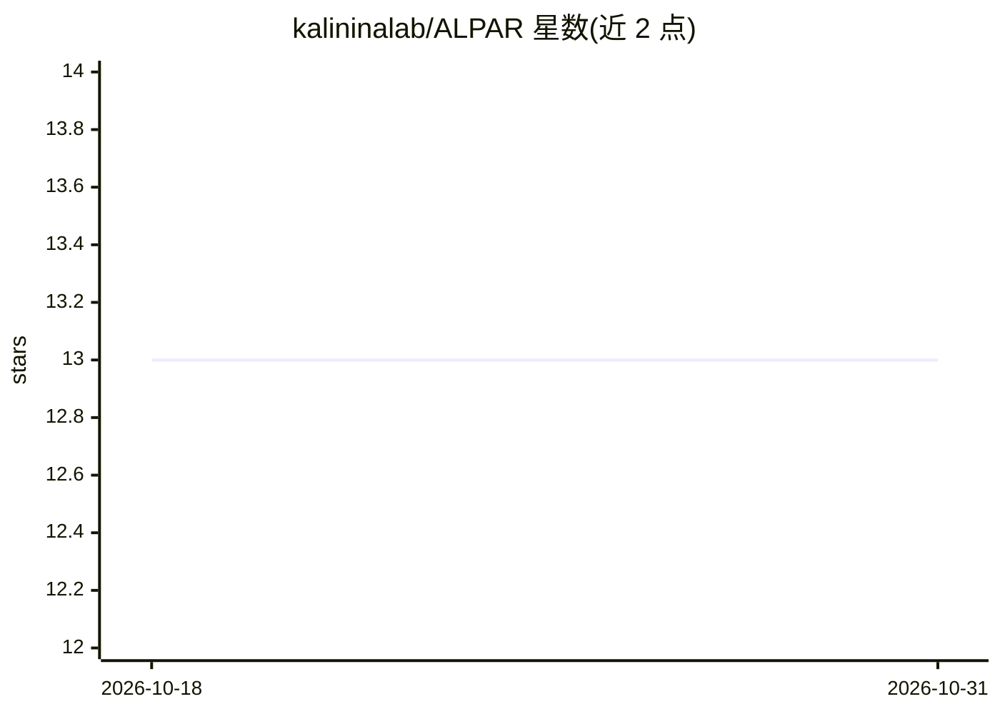

# kalininalab/ALPAR

⭐ 13 · Python · MIT · 推送 2026-10-27 · [GitHub](https://github.com/kalininalab/ALPAR) · [官网](https://alpar.readthedocs.io) · 组织维护

**抗菌素耐药性（AMR）自动化机器学习流水线，供基因组学研究者使用**

ALPAR 是面向抗菌素耐药性研究的命令行流水线：从细菌基因组文件生成二进制突变与表型表格，支持阈值过滤、构建系统发育树（比对无关或基于比对）、GWAS 分析、PRPS 评分（区分与系统发育相关的突变），并用 Random Forest、SVM、Gradient Boosting 训练分类模型，可做参数优化与特征重要性分析，用 DataSAIL 划分训练/测试集以防止信息泄漏。外部工具各自运行在独立 conda 环境中，首次使用时自动创建；主环境需 Python 3.12/3.13 与 conda 24.11。配套 Bioinformatics 论文。

## 筛选速览

| 维度 | 判定 | 备注 |
|---|---|---|
| AI 角色 | `ai-native` | 本体是模型或模型工具 |
| 许可风险 | `permissive` | MIT |
| 部署形态 | `None` |  |
| 模型依赖 | — | README 未给出锁定关系 |
| 硬件要求 | — | 无带数字的原话,不猜 |
| 安装摩擦 | `low` | 无编译、无系统依赖或容器化 |
| 成熟度 | — | 结构信号不足 |

## 能力要点

- 从基因组 fasta 到突变表、表型表、系统发育树、GWAS、ML 训练的一体化流水线
- 三种分类算法（RF/SVM/GB）与特征重要性分析
- PRPS 评分区分与系统发育相关的突变
- 外部工具自动隔离在独立 conda 环境，版本固定保证可复现

## 适用场景

- 我有按抗生素分组的耐药/敏感菌株基因组，想训练耐药预测模型
- 想对大量菌株基因组做变异检测与 GWAS 分析定位耐药突变
- 希望按防信息泄漏策略划分数据集并评估模型特征重要性

## 场景标签

`科研工具` · 领域:学习与行业

## 证据(README 行号)

> L57: From genomic files, creates binary mutation and phenotype tables, applies thresholds, creates phylogenetic tree, co

## 星数曲线

2026-10-18 13 → 2026-10-31 13（+0）

---
*卡片 v1 · prompt 1.4 · 生成 2026-10-31 · 置信度 high · 依据 README sha `2a85d9c3a7dc` · [字段定义](../../DATASET.md)*
