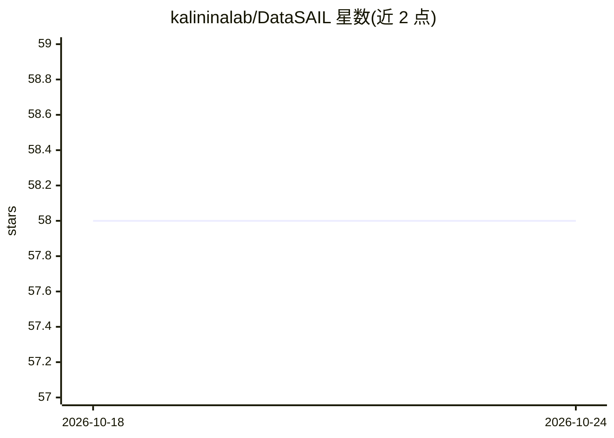

# kalininalab/DataSAIL

⭐ 58 · Python · MIT · 推送 2026-10-21 · [GitHub](https://github.com/kalininalab/DataSAIL) · [官网](https://datasail.readthedocs.io) · 组织维护

**数据集切分工具：降低切分间的信息泄露**

DataSAIL 通过最小化切分之间的样本相似度来划分数据集，以避免因样本间相似导致的信息泄露和高估模型性能。最初面向生物数据集的机器学习工作流开发，也可用于任意类型数据。提供命令行接口与 Python 包两种使用方式，底层采用优化方法（ILP/SCIP）求解切分；MMseqs2、CD-HIT 等第三方聚类工具需单独安装并加入 PATH。要求 Python 3.10 及以上。

## 筛选速览

| 维度 | 判定 | 备注 |
|---|---|---|
| AI 角色 | `ai-ecosystem` | LLM/agent 周边工具 |
| 许可风险 | `permissive` | MIT |
| 部署形态 | `library` | 以包/库形式分发 |
| 模型依赖 | — | README 未给出锁定关系 |
| 硬件要求 | — | 无带数字的原话,不猜 |
| 安装摩擦 | `low` | 无编译、无系统依赖或容器化 |
| 成熟度 | — | 结构信号不足 |

## 能力要点

- 以最小化切分间相似度的方式切分一维与多维数据
- 同时提供 CLI 与 Python 包接口
- 支持 pip 与 conda/mamba 安装，要求 Python ≥3.10
- MMseqs2、CD-HIT、FoldSeek、MASH 等聚类工具需另行安装

## 适用场景

- 训练模型前对数据集做去相似切分，避免信息泄露
- 蛋白质或蛋白质-配体数据集的验证/测试集划分
- 让验证与测试数据在切分间保持新颖，贴近真实推理场景

## 场景标签

 · 领域:机器学习/数据工程

## 证据(README 行号)

> L13: DataSAIL, short for Data Splitting Against Information Leakage, is a versatile tool designed to partition data whil
> L17: DataSAIL was initially developed for machine learning workflows involving biological datasets, but its utility exte

## 星数曲线

2026-10-18 58 → 2026-10-24 58（+0）

---
*卡片 v1 · prompt 1.4 · 生成 2026-10-24 · 置信度 mid · 依据 README sha `a361cd9bcc16` · [字段定义](../../DATASET.md)*
