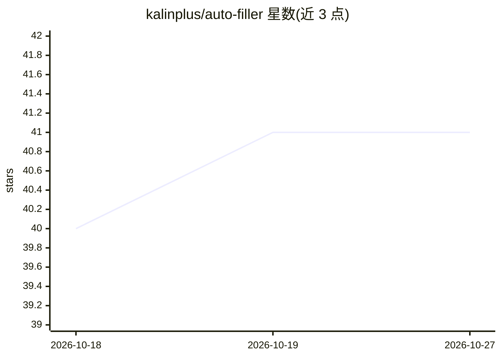

# kalinplus/auto-filler

⭐ 41 · TypeScript · Apache-2.0 · 推送 2026-09-22 · [GitHub](https://github.com/kalinplus/auto-filler) · [官网](https://github.com/kalinplus/auto-filler/releases/latest) · 个人维护 · 中文 README

**基于 LLM 语义匹配的 Chrome 表单自动填充扩展**

面向普通用户的浏览器扩展：扫描网页表单字段（label、placeholder、aria-label 等），通过 LLM 语义匹配将本地存储的个人信息自动填入，展示置信度供用户逐项确认。另提供证明材料分类管理、浏览器端 PDF 合成功能。支持任何 OpenAI 兼容 API，预置主流供应商配置，需用户自填 API Key；所有数据本地存储（IndexedDB + chrome.storage.local），无需注册账号。从 Release 下载 zip 拖入浏览器安装，或 npm 构建源码。

## 筛选速览

| 维度 | 判定 | 备注 |
|---|---|---|
| AI 角色 | `ai-native` | 本体是模型或模型工具 |
| 许可风险 | `permissive` | Apache-2.0 |
| 部署形态 | `library` | 以包/库形式分发 |
| 模型依赖 | — | README 未给出锁定关系 |
| 硬件要求 | — | 无带数字的原话,不猜 |
| 安装摩擦 | `low` | 无编译、无系统依赖或容器化 |
| 成熟度 | — | 结构信号不足 |

## 能力要点

- LLM 语义匹配个人信息与表单字段，含置信度逐项确认
- 证明材料分类管理与纯浏览器端 PDF 合成（A4 自适应）
- 支持任何 OpenAI 兼容 API 与自定义 Base URL
- 所有数据本地存储，无需注册账号

## 适用场景

- 填写报名、注册等重复性网页表单时自动填入个人信息
- 整理身份证明、学历证明等材料并按需合成一份 PDF
- 使用国内厂商或第三方 OpenAI 兼容 API 完成匹配

## 场景标签

`浏览器自动化` · 领域:效率与自动化

## 证据(README 行号)

> L5: 一款基于 LLM 语义匹配的 Chrome 表单自动填充扩展。支持文本字段填充和 PDF 证明材料按需合成，所有数据本地存储，无需注册账号。
> L17: - 通过 LLM 语义匹配，将用户存储的个人信息自动填入对应字段

## 星数曲线

2026-10-18 40 → 2026-10-27 41（+1）

---
*卡片 v1 · prompt 1.4 · 生成 2026-10-25 · 置信度 high · 依据 README sha `cc6cd017ebee` · [字段定义](../../DATASET.md)*
