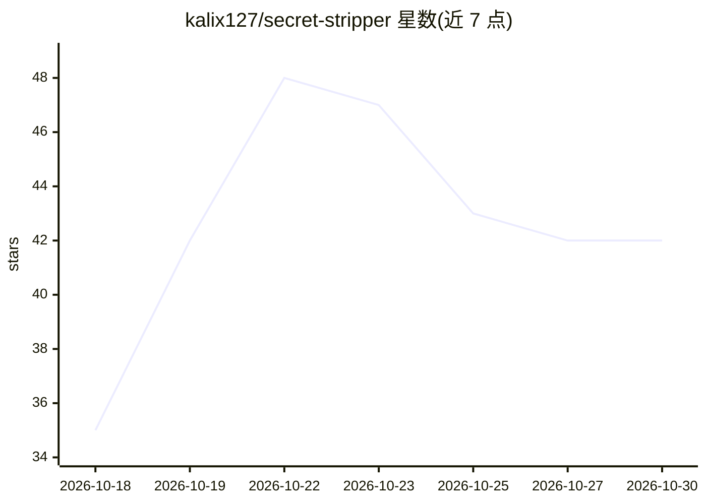

# kalix127/secret-stripper

⭐ 42 · Rust · MIT · 推送 2026-10-28 · [GitHub](https://github.com/kalix127/secret-stripper) · 个人维护

**Linux 剪贴板脱敏粘贴工具：一键粘贴前隐藏密钥与 PII**

面向 Linux 桌面用户的剪贴板脱敏工具：按热键粘贴时本地扫描剪贴板内容，将 API 密钥、令牌、私钥与 PII（850+ 模式）替换为 [REDACTED] 等样式，原剪贴板保持不变，全程无网络访问。支持 X11 与 Wayland（Wayland 需经 /dev/uinput 虚拟键盘），适配 GNOME/KDE/Hyprland/sway 等桌面。另提供管道 redact 命令、包裹 AI CLI 工具的 paste-guard、可选 OCR 截图脱敏（需 tesseract）及自定义正则模式。2.0 仅支持 Linux，macOS/Windows 停留在 1.5.2。

## 筛选速览

| 维度 | 判定 | 备注 |
|---|---|---|
| AI 角色 | `ai-enhanced` | 去掉 AI 部分产品仍成立 |
| 许可风险 | `permissive` | MIT |
| 部署形态 | `desktop` | 安装包/桌面程序 |
| 模型依赖 | — | README 未给出锁定关系 |
| 硬件要求 | — | 无带数字的原话,不猜 |
| 安装摩擦 | `low` | 无编译、无系统依赖或容器化 |
| 成熟度 | — | 结构信号不足 |

## 能力要点

- 850+ 内置检测模式覆盖云密钥、令牌、私钥、连接串与 PII，支持自定义 patterns.toml
- 热键粘贴脱敏副本，原剪贴板保留，本地扫描无网络访问
- paste-guard PTY 包装器拦截进入 AI CLI（Claude Code、Codex、aider 等）的括号粘贴
- 可选 OCR 截图脱敏与管道 redact 命令

## 适用场景

- 把含密钥的日志或配置粘贴进 AI 聊天、工单前自动脱敏
- 在终端用专用热键粘贴已清理秘密的内容
- 对 Claude Code、aider 等 AI CLI 的粘贴内容做防护

## 场景标签

`网络安全` · 领域:学习与行业

## 证据(README 行号)

> L3: **Paste a redacted copy of your clipboard with one hotkey. Copy as usual, press `Ctrl+Alt+V`, and API keys, tokens, 
> L44: 1. reads the clipboard and scans it locally, with no network access;

## 星数曲线

2026-10-18 35 → 2026-10-30 42（+7）

---
*卡片 v1 · prompt 1.4 · 生成 2026-10-25 · 置信度 high · 依据 README sha `a05ca45d55ba` · [字段定义](../../DATASET.md)*
