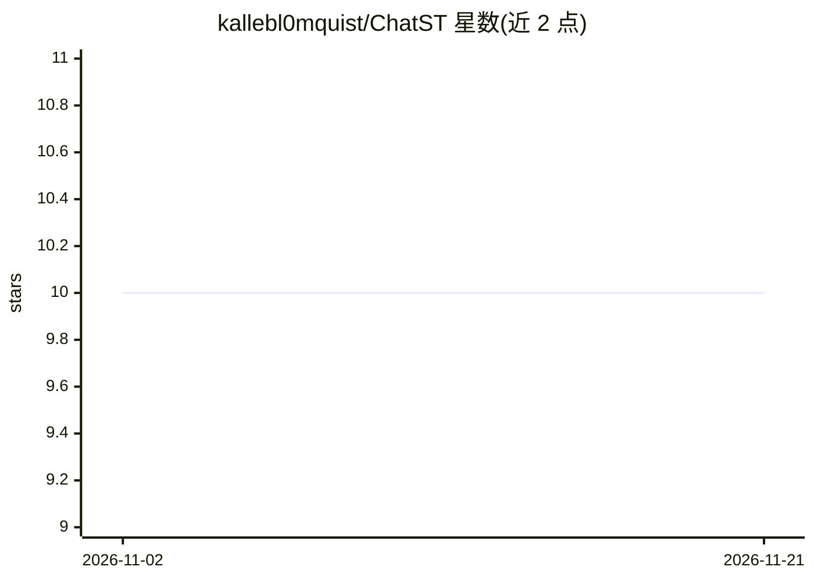

# kallebl0mquist/ChatST

⭐ 10 · Python · GPL-3.0 · 推送 2026-04-17 · [GitHub](https://github.com/kallebl0mquist/ChatST) · 个人维护

**让 Atari ST 老电脑通过串口连接现代 LLM 的 GEM 聊天客户端**

作者用 GFA BASIC 3.5E 在真实 Atari Mega STE 硬件上编写的 GEM 窗口聊天客户端，采用双机架构：Atari 侧负责 UI、聊天历史、键盘处理与串口收发；树莓派侧运行 Python 桥接脚本，把串口协议转为 HTTP API 调用。自定义长度前缀的 ASCII 块协议，本地聊天记录存为 .CHT 文件。需要 Mega STE、GFA BASIC 3.5、树莓派与 RS232 空调制解调器串口线。作者自述定位为趣味实验（party trick）而非实用工具。

## 筛选速览

| 维度 | 判定 | 备注 |
|---|---|---|
| AI 角色 | `ai-native` | 本体是模型或模型工具 |
| 许可风险 | `viral` | GPL-3.0 |
| 部署形态 | `None` |  |
| 模型依赖 | — | README 未给出锁定关系 |
| 硬件要求 | — | 无带数字的原话,不猜 |
| 安装摩擦 | `low` | 无编译、无系统依赖或容器化 |
| 成熟度 | — | 结构信号不足 |

## 能力要点

- Atari 侧保持极简，网络/API 逻辑全部放在树莓派 Python 桥接
- 自定义长度前缀、纯 ASCII 的块式串口协议，9600 bps 传输
- 本地 .CHT 长度寻址聊天文件格式，支持多会话
- GEM 窗口 UI 含滚动消息区与多会话侧栏

## 适用场景

- 在真实 Atari ST 硬件上体验现代 LLM 对话
- 复现旧硬件与树莓派的串口桥接项目
- 学习 GFA BASIC 与串口协议开发

## 场景标签

`聊天机器人` · 领域:对话与助手

## 证据(README 行号)

> L3: I have been building a GEM-based LLM chat client for the Atari ST in GFA BASIC 3.5E. What if an Atari ST could talk 
> L14: I did not want to run networking code on the Atari itself. The Atari app should stay small, understandable, and deb

## 星数曲线

2026-11-02 10 → 2026-11-21 10（+0）

---
*卡片 v1 · prompt 1.4 · 生成 2026-11-19 · 置信度 high · 依据 README sha `af725d43ab63` · [字段定义](../../DATASET.md)*
