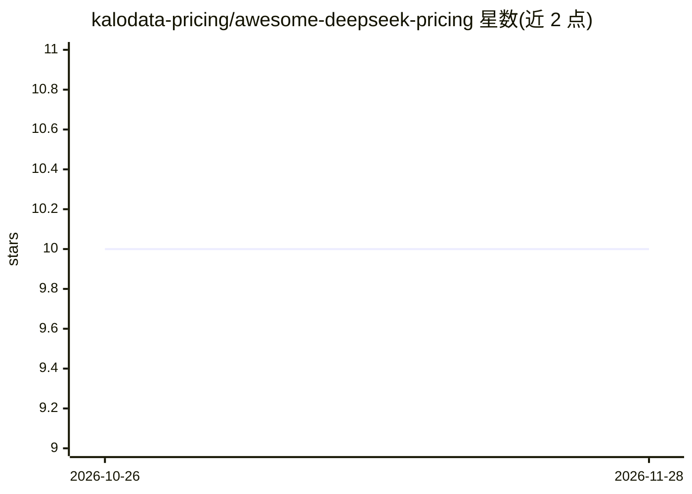

# kalodata-pricing/awesome-deepseek-pricing

⭐ 10 · 推送 2026-09-22 · [GitHub](https://github.com/kalodata-pricing/awesome-deepseek-pricing) · [官网](https://synexa.ai?utm_source=github&utm_medium=ugc&utm_campaign=awesome-deepseek-pricing&utm_content=readme-top&utm_term=tier-r) · 个人维护

**DeepSeek API 定价信息策展清单：费率表、缓存与限流文档索引**

面向需要查询 DeepSeek API 定价的开发者整理的非官方社区清单：收录官方 Models & Pricing 费率表、缓存命中与并发限流文档、独立定价计算器以及价格变更记录页面，并对独立站点做标注。覆盖 deepseek-flash 与 deepseek-v4-pro 两个模型，按官方资源、入门教程、工具与替代方案等类别组织条目。README 不含安装或运行方式，仅提供链接索引与简要说明。

## 筛选速览

| 维度 | 判定 | 备注 |
|---|---|---|
| AI 角色 | `ai-knowledge` | 知识聚合/清单类 |
| 许可风险 | `none` | — |
| 部署形态 | `None` |  |
| 模型依赖 | — | README 未给出锁定关系 |
| 硬件要求 | — | 无带数字的原话,不猜 |
| 安装摩擦 | `low` | 无编译、无系统依赖或容器化 |
| 成熟度 | — | 结构信号不足 |

## 能力要点

- 收录官方费率表：每百万 token 价格、缓存命中/未命中、峰谷时段与并发上限
- 解释 Context Caching 与 Rate Limit 的机制文档
- 收录独立定价计算器（峰值/谷值对比）
- 标注条目是否由 DeepSeek 官方运营

## 适用场景

- 查询 deepseek-flash 与 v4-pro 的 token 价格与峰谷费率
- 理解缓存命中如何影响 API 成本
- 查找官方快速上手与 API 接入文档入口

## 场景标签

`精选清单` · 领域:学习与行业

## 证据(README 行号)

> L1: # Awesome DeepSeek pricing
> L5: A curated list of pages that answer deepseek pricing questions: the official Models & Pricing table for `deepseek-fl

## 星数曲线

2026-10-26 10 → 2026-11-28 10（+0）

---
*卡片 v1 · prompt 1.4 · 生成 2026-11-20 · 置信度 high · 依据 README sha `d6527ed042bf` · [字段定义](../../DATASET.md)*
