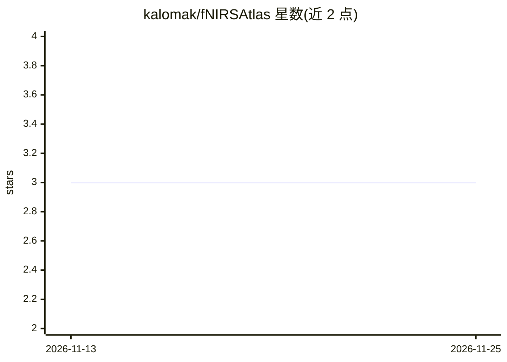

# kalomak/fNIRSAtlas

⭐ 3 · Python · MIT · 推送 2026-11-21 · [GitHub](https://github.com/kalomak/fNIRSAtlas) · [官网](https://fnirsatlas.github.io/) · 个人维护

**面向 fNIRS 研究者的脑机接口数据基准与分类流水线库**

一个解析、预处理并分类 fNIRS 数据集的 Python 包：聚合 20+ 数据集（运动、心算、运动想象、情绪、MISC 等 suite），提供从原始数据下载到分类的全自动流水线。评估采用跨被试/被试内嵌套交叉验证，内置 LDA 与 EEGNet 基线模型，支持接入自定义 PyTorch/scikit-learn 模型并进行模型间统计比较。处理后数据以无依赖的通用格式导出（原始数据约 60GB，处理后约 800MB），完整基准需集群或 Slurm/Snakemake 运行。

## 筛选速览

| 维度 | 判定 | 备注 |
|---|---|---|
| AI 角色 | `ai-native` | 本体是模型或模型工具 |
| 许可风险 | `permissive` | MIT |
| 部署形态 | `library` | 以包/库形式分发 |
| 模型依赖 | — | README 未给出锁定关系 |
| 硬件要求 | — | 无带数字的原话,不猜 |
| 安装摩擦 | `low` | 无编译、无系统依赖或容器化 |
| 成熟度 | — | 结构信号不足 |

## 能力要点

- 20+ fNIRS 数据集、多 suite 基准，原始→分类全自动流水线
- 嵌套交叉验证评估（默认外层 seeds×5 折、内层 4 折）
- 内置 LDA 与 EEGNet 基线，可接入自定义 PyTorch/sklearn 模型并统计比较
- 处理后数据统一 .npz 格式，无依赖即可使用

## 适用场景

- 在自己的模型上跑 fNIRS 基准并与基线对比
- 一键下载并预处理公开 fNIRS 数据集
- 跨被试/被试内分类实验的复现与超参搜索
- 以通用格式加载处理后数据用于下游分析

## 场景标签

`模型评测` `科研工具` · 领域:评测与运维

## 证据(README 行号)

> L8: fNIRSAtlas is a Python package for parsing, preprocessing, and classifying fNIRS datasets with a unified, extensible
> L14: - Largest benchmark/collection of fNIRS datasets: 20+ datasets, multiple suites (Motor, MA, MI, Emotion, MISC)
> L18: - Cross- and within-subject classification with nested cross-validation (default: outer CV=seeds x 5-fold, inner CV

## 星数曲线

2026-11-13 3 → 2026-11-25 3（+0）

---
*卡片 v1 · prompt 1.4 · 生成 2026-11-21 · 置信度 high · 依据 README sha `ff7f3d4a5c4e` · [字段定义](../../DATASET.md)*
