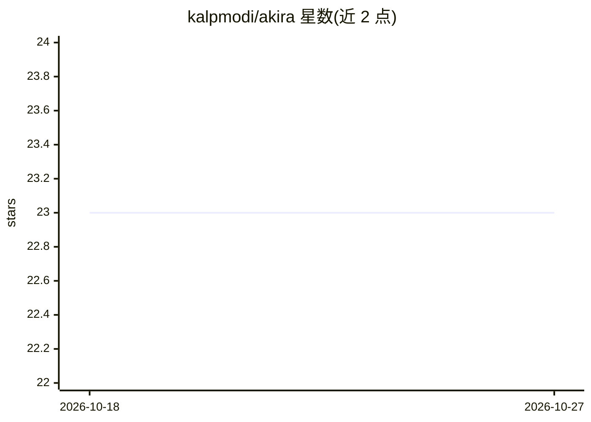

# kalpmodi/akira

⭐ 23 · Dockerfile · MIT · 推送 2026-07-12 · [GitHub](https://github.com/kalpmodi/akira) · 个人维护

**在编码 Agent 内运行的 AI 渗透测试技能系统，覆盖侦察到报告全流程**

以技能（skills）与命令（/plan-engagement → /recon → … → /report）形式运行于 Claude Code、Gemini CLI、Cursor 等 Agent 环境的渗透测试协作系统。核心机制：session.json 状态总线、贝叶斯假设引擎按信号实时更新后验概率并驱动 WIDE/DEEP/HARVEST/WRAP 状态机、router 按优先级（MUST/SHOULD/IF_TIME/SKIP）加载技术文件以降低 token 成本、signals.jsonl 原子追加的信号总线与 doom-loop 检测。证据标准：每个发现须有包含敏感数据的可复现 HTTP 响应体。附带密码学弱点、二阶 SSTI、HTTP 走私、供应链/CI-CD 等技术选型说明。面向渗透测试与漏洞赏金开发者。

## 筛选速览

| 维度 | 判定 | 备注 |
|---|---|---|
| AI 角色 | `ai-ecosystem` | LLM/agent 周边工具 |
| 许可风险 | `permissive` | MIT |
| 部署形态 | `library` | 以包/库形式分发 |
| 模型依赖 | — | README 未给出锁定关系 |
| 硬件要求 | — | 无带数字的原话,不猜 |
| 安装摩擦 | `medium` | 含编译或系统依赖之一 |
| 成熟度 | — | 结构信号不足 |

## 能力要点

- 贝叶斯假设引擎按信号实时更新后验概率（log-space 实现）
- WIDE/DEEP/HARVEST/WRAP 四态状态机驱动测试阶段
- router + manifest 优先级系统按需加载技术文件以削减 token 成本
- 证据约束：发现须附含敏感数据的可复现 HTTP 响应体

## 适用场景

- 在 Claude Code/Cursor 等 Agent 中执行从规划到报告的渗透测试流程
- 漏洞赏金项目中寻找扫描器无法覆盖的逻辑缺陷与链式攻击
- 对 JWT 混淆、原型污染、CI/CD 泄露等特定向量做系统化测试

## 场景标签

`网络安全` · 领域:学习与行业

## 证据(README 行号)

> L17: An AI pentest co-pilot that runs natively inside Claude Code, Gemini CLI, Cursor, or any agent. It is not a wrapper
> L22: /plan-engagement → /recon → /secrets → /exploit → /zerodayhunt → /triage → /report

## 星数曲线

2026-10-18 23 → 2026-10-27 23（+0）

---
*卡片 v1 · prompt 1.4 · 生成 2026-10-27 · 置信度 mid · 依据 README sha `b2618d0229ce` · [字段定义](../../DATASET.md)*
