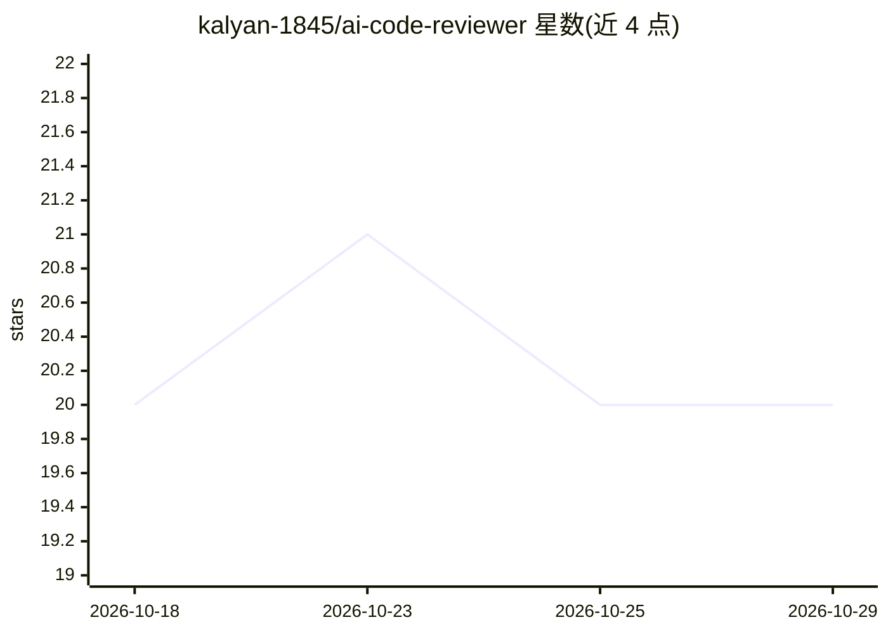

# kalyan-1845/ai-code-reviewer

⭐ 20 · JavaScript · MIT · 推送 2026-08-20 · [GitHub](https://github.com/kalyan-1845/ai-code-reviewer) · [官网](https://ai-code-reviewer-eight-psi.vercel.app) · 个人维护

**AI 自动代码审查工具：分析 PR 与仓库的缺陷与安全问题**

四模块项目：React 前端仪表盘、Node/Express 后端、Python/FastAPI AI 引擎、GitHub Action 机器人。粘贴 GitHub 仓库 URL 即可用 LLM（Llama 3、DeepSeek、Gemma，经 Groq API 调用）做代码审查，检测 bug、反模式、性能瓶颈与风格问题；另含基于正则的密钥泄露扫描、复杂度静态指标（A–F 评级）、README 生成与仓库自然语言问答，支持 13+ 语言。GitHub Action 可在 PR 上逐行发表评论。需自备 Groq API Key，三端分别手动启动，无 Docker。

## 筛选速览

| 维度 | 判定 | 备注 |
|---|---|---|
| AI 角色 | `ai-native` | 本体是模型或模型工具 |
| 许可风险 | `permissive` | MIT |
| 部署形态 | `library` | 以包/库形式分发 |
| 模型依赖 | locked-api |  |
| 硬件要求 | — | 无带数字的原话,不猜 |
| 安装摩擦 | `low` | 无编译、无系统依赖或容器化 |
| 成熟度 | — | 结构信号不足 |

## 能力要点

- LLM 代码审查：bug、反模式、性能瓶颈、风格问题（Llama 3/DeepSeek/Gemma）
- 正则式凭据泄露扫描（API key、AWS secrets、.env 泄露）
- GitHub Action 机器人在 PR 上发布逐行审查评论
- 复杂度指标（LOC、注释密度、A–F 评级）与一键 README 生成、仓库问答

## 适用场景

- 把公开 GitHub 仓库粘贴进仪表盘做一次 AI 代码体检
- 在 PR 流程中自动获得逐行 AI 审查评论
- 扫描仓库中的密钥泄露与生成项目 README

## 场景标签

`代码审查` · 领域:编码与开发

## 证据(README 行号)

> L15: Developers spend **60% of their time** reading and reviewing code. **RepoSage** automates this with AI — analyzing 
> L25: ### 🔍 AI Code Review
> L64: |**AI Engine**|Python 3.10 + FastAPI|LLM-powered code review, bug detection, and README generation|

## 星数曲线

2026-10-18 20 → 2026-10-29 20（+0）

---
*卡片 v1 · prompt 1.4 · 生成 2026-10-28 · 置信度 mid · 依据 README sha `95e4bc64b7c0` · [字段定义](../../DATASET.md)*
