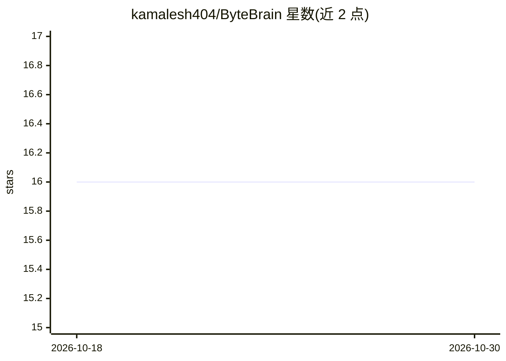

# kamalesh404/ByteBrain

⭐ 16 · TypeScript · MIT · 推送 2026-10-29 · [GitHub](https://github.com/kamalesh404/ByteBrain) · 个人维护

**浏览器内本地运行 LLM 的学习助手：无需 API key 的私有问答**

面向学生与研究者的网页端 AI 学习伴侣：通过 WebGPU 与 @mlc-ai/web-llm 在本地 GPU 上直接运行量化后的 Phi-3-mini-4k-instruct 模型（首次提示词时从 Hugging Face/MLC CDN 下载约 1.8-2.3 GB 权重），对话、笔记与文档均在浏览器内处理，不发送到外部服务器。支持 PDF 文本抽取（pdfjs-dist）、图片 OCR（tesseract.js）、Web Worker 非阻塞生成与缓存管理。需 Chrome/Edge 113+ 且支持 WebGPU，4 GB+ VRAM，模型上下文窗口 4,096 token。通过 git clone + npm ci + npm run dev 从源码运行。

## 筛选速览

| 维度 | 判定 | 备注 |
|---|---|---|
| AI 角色 | `ai-native` | 本体是模型或模型工具 |
| 许可风险 | `permissive` | MIT |
| 部署形态 | `None` |  |
| 模型依赖 | — | README 未给出锁定关系 |
| 硬件要求 | — | 无带数字的原话,不猜 |
| 安装摩擦 | `low` | 无编译、无系统依赖或容器化 |
| 成熟度 | — | 结构信号不足 |

## 能力要点

- WebGPU + WebLLM 在浏览器本地运行 LLM 推理，无需 API key
- PDF 文本抽取与 tesseract.js 客户端 OCR
- LLM 计算置于 Web Worker，生成期间 UI 不阻塞
- 对话与文档不出浏览器，可查看/清除缓存模型权重

## 适用场景

- 不订阅云端 API、在本地电脑上做私有学习问答
- 上传课件 PDF 或笔记截图提取文本并向 AI 提问
- 离线复用已缓存模型（首次下载完成后）继续学习

## 场景标签

`AI 助手` `文档问答` · 领域:对话与助手

## 证据(README 行号)

> L6: ByteBrain is an in-browser, local-first AI study companion designed for students, researchers, and lifelong learners
> L12: - **Local-First AI Execution:** Large language model inference runs on your device using WebGPU and `@mlc-ai/web-ll

## 星数曲线

2026-10-18 16 → 2026-10-30 16（+0）

---
*卡片 v1 · prompt 1.4 · 生成 2026-10-30 · 置信度 high · 依据 README sha `9e75f24c9abd` · [字段定义](../../DATASET.md)*
